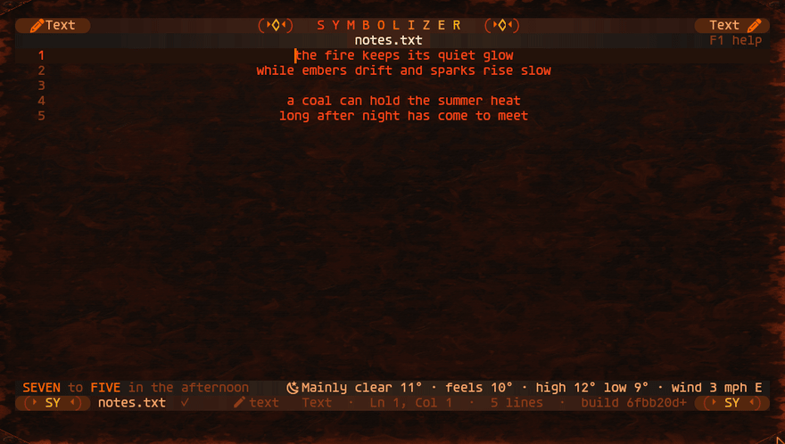
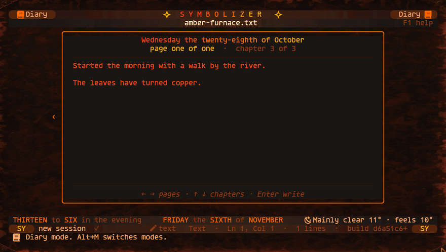
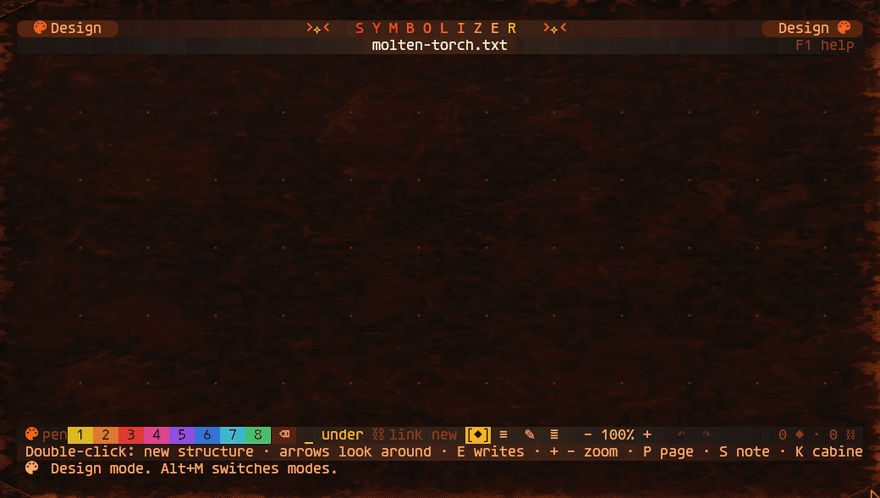
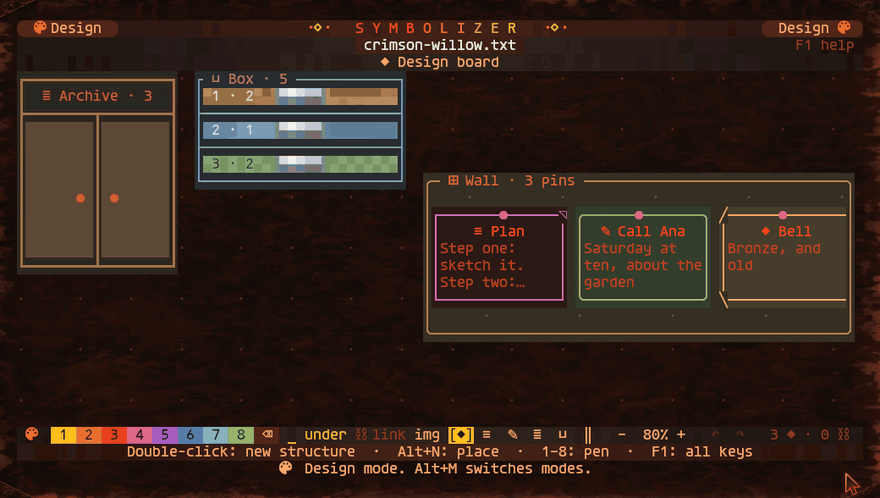
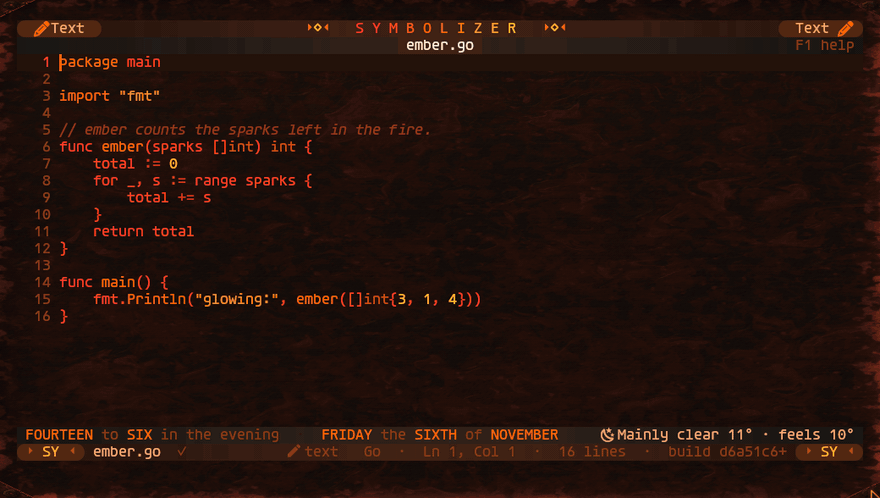

<div align="center">


<br>


### Your whole workspace, in the terminal.
Write and code · keep a diary · run your projects · design in 3D · make programs from plain English

Embers on charcoal. It saves by itself.

[Install](#-install) · [Keys](#-keys) · [Modes](#-modes) · [Brick](#-brick) · [Design](#-design) · [More](#-more)

<br>


</div>

<br>

## ✦ Install

```sh
git clone https://github.com/tuniveza/symbolizer
cd symbolizer
go build -o sy .
ln -s "$PWD/sy" ~/.local/bin/sy
```

Needs **Go 1.27**. Best in **[kitty](https://sw.kovidgoyal.net/kitty/)** with a **Nerd Font**.

```text
sy                 carry on where you left off
sy notes.txt       open a file          sy ~/web     open a folder as a project
sy diary           Diary                sy manager   Manager
sy brick           Brick                sy design    Design
```

**F1** shows every key · **Alt + Q** quits · nothing is ever unsaved

<br>

## ✦ Keys

Hold a key and the arrows change what they do. The status bar always says which.

<div align="center">

</div>

| Hold | The arrows |
|:---:|:---|
| — | step a word |
| **Shift** | highlight |
| **Ctrl** | step a letter |
| **Alt** | jump to the line's ends, or a block |
| **Alt + Shift** | move the text or the line |

<div align="center">

</div>

<br>

## ✦ Modes

**Alt + M** switches between them.

| | |
|:---|:---|
| **Text** | The editor. A centred column, syntax colours, Emmet in web files, brackets that close themselves. |
| **Diary** | A chapter a day, plain-text pages. **Left / Right** turn pages, **Alt + N** a new one. |
| **Manager** | All your projects on one screen. Type to search, **F6** run, **F7** build. |
| **Brick** | Programs written in plain English. [See below](#-brick). |
| **Design** | A board made of text, flat or as a 3D room. [See below](#-design). |

<div align="center">

</div>

<br>

## ✦ Brick

[brick](brick/) turns plain English into real Linux programs. It lives in this repo.
In Brick mode every word is coloured by what brick reads it as.

| Key | |
|:---:|:---|
| **Alt + R** | run it (the brain checks it first) |
| **Alt + C** | check it, and fix missing steps |
| **Alt + P** | keys to the panel and back (**Esc** back too) |
| **1 – 7** | in the panel: Bricks, Words, Decisions, Imagination, Neurons, Learning, Phrases |
| **Alt, Alt, B** | tap Left Alt twice, then B: brick mode from any mode |
| **F12** | brick learning on / off, in any mode |

Each panel shows its own keys on its top line, one letter each.
**Bricks**: B bytes of the cursor's line, S save the bits. **Words**: Enter teaches, Delete forgets.
**Learning**: L learning, D your diary, V the brains' voices. **Phrases**: every line brick can build.

The brain checks every line while you type: does it build what the words mean?
Messy lines are read one direction at a time. A word brick has no action for gets a new one, made of what brick can already do.
When the brain finds a fix (precise, or its best pick from the line's meaning), **Alt + R** writes it in before building. **Ctrl + Z** takes it back.
The language model teaches the brain: what it reads right is learned, so the brain reads it by itself next time.
Programs carry only the routines they use: `write hello` is 335 bytes.
The brains' voices: each archetype says what it learns, in its own voice.
The **Bricks** panel shows every brick in use, live, coloured by kind.
An empty file shows lines to start with. **F1** has the rest.

brick learns from what you write. It stays on your computer.
Your diary is read only when you switch it on.

<br>

## ✦ Design

A board you build with text: shapes with pictures, pages, notes, cabinets, drawers, racks, boards and boxes.

- **Alt + N** places a new thing. **Drag** to move. **X X** deletes. **Ctrl + Z** undoes.
- **Arrows** jump between things. **Tab** writes in one.
- **Drop files** from your file manager onto the board.
- **Ctrl + F** walks into it as a 3D room, with its own music.

<div align="center">

<br><br>

</div>

<br>

## ✦ More

| | |
|:---|:---|
| **Files** | **Alt + O** opens the file manager. Type to find any file. |
| **Terminal** | **AltGr + T** opens a kitty terminal under the text. |
| **Themes** | **Alt + T**: six themes, shown live on your text. |
| **Learn** | **AltGr + L**: how to write the language you're in, today. |
| **Sessions** | Text with no name is kept anyway, and given a name from what it says. |

<div align="center">

<br>
<sub>Emberistal · Emberline · Molten · Ash · Cinder · Daybreak</sub>
</div>

<details>
<summary><b>kitty and Hyprland setup</b></summary>

<br>

kitty keeps **Ctrl + Shift + arrows** for itself. Give them to Symbolizer in `kitty.conf`:

```conf
map --when-focus-on title:Symbolizer kitty_mod+left
map --when-focus-on title:Symbolizer kitty_mod+right
map --when-focus-on title:Symbolizer kitty_mod+up
map --when-focus-on title:Symbolizer kitty_mod+down
```

In Hyprland, let **Alt + Tab** through when the active window's title ends in "— Symbolizer".

</details>

<details>
<summary><b>Tests</b></summary>

<br>

```sh
go test ./...          # every key and command
python3 tests/e2e.py   # the real sy in a test terminal (pip install pyte)
```

</details>

<br>

<div align="center">
<sub>Made by <a href="https://github.com/tuniveza">tuniveza</a> with Claude · Emberistal colours · ✦</sub>
</div>
