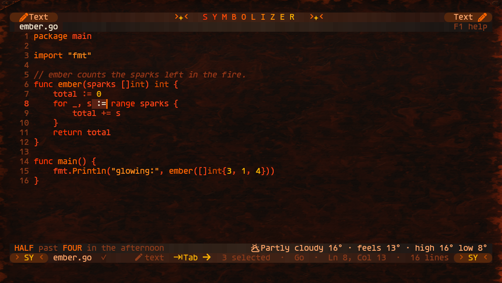
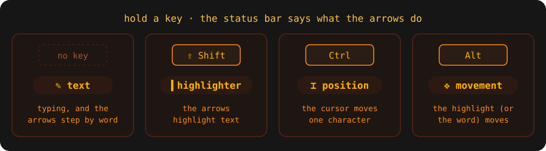
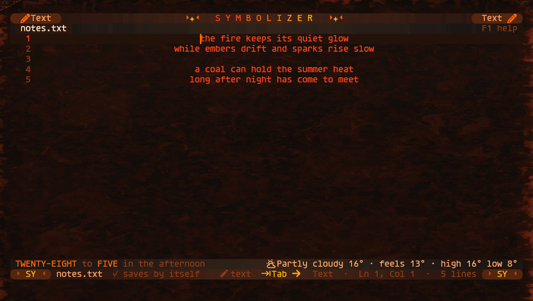
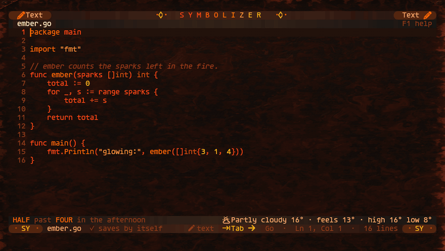
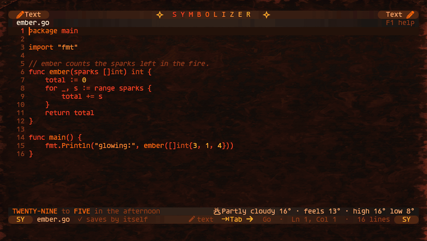
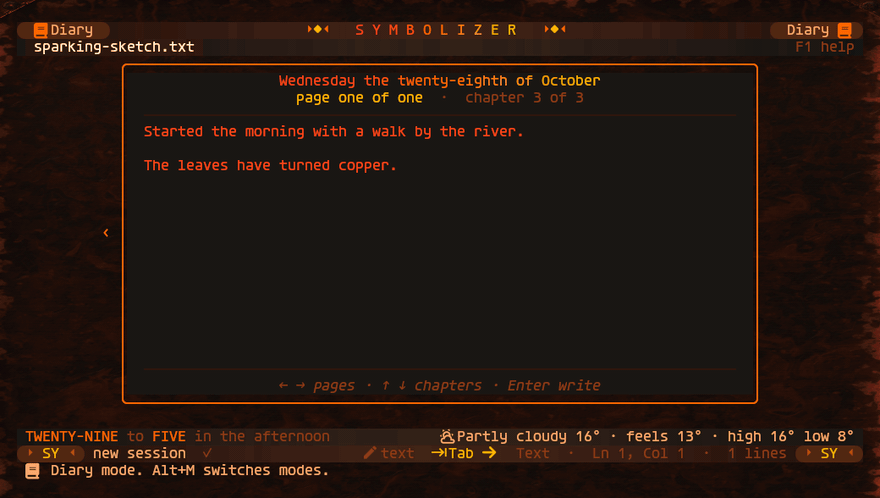
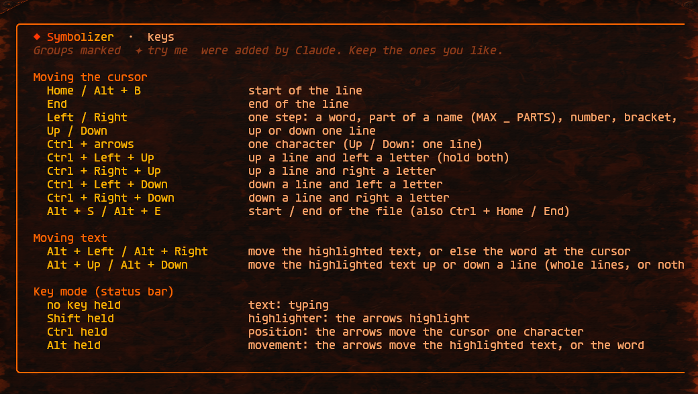

<div align="center">



<br>


**A text editor for the terminal, in the Emberistal theme.**
<br>
Embers on charcoal. It saves by itself. Every key is meant for your hands.

[Install](#-install) · [Key modes](#-key-modes) · [File manager](#-file-manager) · [Themes](#-colour-themes) · [Diary](#-diary) · [Every key](#-every-key)

<br>



</div>

<br>

## ✦ What it is

- **A calm editor.** The text sits in a centred column. The bars glow a little warmer in the middle.
- **Nothing to lose.** Every change saves itself a moment later. Text with no name is kept as a **session**.
- **Keys that say what they do.** Hold Shift, Ctrl or Alt and the status bar tells you what the arrows will do.
- **More than one kind of work.** Text and Diary work today. Design, Slides, Book and Draw are on the way.

## ✦ Install

You need **Go 1.27** or newer.

```sh
git clone https://github.com/tuniveza/symbolizer
cd symbolizer
go build -o sy .
ln -s "$PWD/sy" ~/.local/bin/sy     # so `sy` works from anywhere
```

It runs in any terminal. It looks its best in **[kitty](https://sw.kovidgoyal.net/kitty/)** with a **Nerd Font**: kitty tells Symbolizer when a key goes up, so held keys work exactly.

## ✦ Start

```text
sy                 carry on with today's session (a draft with no name)
sy notes.txt       open (or create) notes.txt
sy notes.txt +42   open notes.txt at line 42
sy ~/projects/web  open a folder as a project, with the file manager
sy diary           Diary mode
sy design          Design mode   (also: slide, book, draw)
sy --keys          show what each key does
```

Inside, press **F1** for every key. **Alt + Q** quits. Everything is already saved.

<br>

## ✦ Key modes

<div align="center">

</div>

<br>

| Hold | Mode | The arrows… |
|:---:|:---|:---|
| nothing | ✎ **text** | step by word: a word, part of a name (`MAX` `_` `PARTS`), a number, a bracket, an operator like `+=` |
| **Shift** | ▍ **highlighter** | highlight, one step at a time (Ctrl + Shift: one character) |
| **Ctrl** | ⌶ **position** | move the cursor one character. Hold two arrows at once to go diagonally |
| **Alt** | ✥ **movement** | move the highlighted text. Nothing highlighted: the word swaps places with its neighbour, and Up / Down move the whole line |

<div align="center">

<br>
<sub>Ctrl steps letter by letter · Alt carries the word “fire” along · Shift highlights · Alt moves the highlight down a line and back · then the whole line moves</sub>
</div>

<br>

## ✦ File manager

A box that floats over the text, with an icon for each kind of file.
**Type letters** to find a file anywhere in the project.

| Keys | What it does |
|:---|:---|
| **Alt + O**, **AltGr + O** (ø), or tap **AltGr** twice | open the file manager |
| **Alt + E**, **AltGr + E**, or **Esc** | close it |
| **Enter** / **Right** | open a file, or open a folder |
| **Ctrl + N** · **F7** · **F2** · **Del** | new file · new folder · rename · move to the Trash |

<div align="center">

</div>

<br>

## ✦ Colour themes

**Alt + T** (or **ŧ**, Right Alt + T) shows six themes. The arrows show each one on the real text right away.
**Enter** keeps it. **Esc** puts the old one back. Only Symbolizer changes, never the rest of the desktop.

<div align="center">

<br>
<sub>Emberistal · Emberline · Molten · Ash · Cinder · Daybreak</sub>
</div>

<br>

## ✦ Diary

`sy diary` (or **Alt + M** → Diary). Each day is a chapter, and each chapter holds pages.
Pages are plain text files: `~/.local/share/symbolizer/diary/2026-10-28/001.txt`.

| Keys | What it does |
|:---|:---|
| **Left / Right** | previous / next page (on into the day before or after) |
| **Up / Down** | previous / next day |
| **Alt + N** or AltGr + N (”) | a new page for today, open to write on |
| **Alt + A** or AltGr + A (æ) | every page at once. Enter shows the chosen page |
| **Enter** / **Esc** | write on the page / back to the pages |

<div align="center">

</div>

<br>

## ✦ Saving and sessions

- Everything saves by itself a moment after each change.
- Text with no name is a **session**, kept in `~/.local/share/symbolizer/sessions`. Its tab gets a made-up file name from its text (first function, heading or words, like `tidy_room.py`), or an ember name like `molten-lantern.txt`.
- `sy` carries on with the session changed in the last 24 hours. After 24 hours with no change, `sy` starts a new one. The old one waits in the **Alt + L** list.
- **Ctrl + S** on a session asks for a name. The ending comes from what the text looks like: `hello` becomes `hello.py`, `hello.c` …
- If another program changes an open file, saving pauses instead of writing over it.

## ✦ Every key

Press **F1** inside Symbolizer for the full, scrollable list.

<div align="center">

</div>

<details>
<summary><b>The whole list, here</b></summary>

<br>

| Keys | What it does |
|:---|:---|
| Left / Right | cursor one step: a word, part of a name, number, bracket, or operator |
| Up / Down | up / down a line |
| Home / Alt + B · End | start / end of the line |
| Alt + S / Alt + E | start / end of the file (also Ctrl + Home / End) |
| Ctrl + arrows | cursor one character (Up / Down: one line) |
| Ctrl + Left + Up (hold both), and the other 3 pairs | one line and one letter at once |
| Shift + Left / Right | highlight one step |
| Ctrl + Shift + arrows | highlight one character (Up / Down: one line) |
| Alt + Left / Right | move the highlighted text one letter, or swap the word with the next one |
| Alt + Up / Down | move the highlighted text a line, in its column; whole lines or nothing highlighted: the line moves |
| Ctrl + C · Ctrl + X · Ctrl + V / Ctrl + P | copy · cut · paste |
| Ctrl + Z · Ctrl + Y | undo · redo |
| Ctrl + F · Ctrl + R · Ctrl + G | find · replace · go to line |
| Ctrl + D · Ctrl + K · Ctrl + / | duplicate · delete line · comment |
| Ctrl + S or ß (Right Alt + S) | save now (a session is asked for a name) |
| Alt + A | save under a new name |
| Alt + L | load: sessions, or this file again from disk |
| Alt + N / Alt + C | new file in a new tab / close this file |
| Alt + 1 … 9 · Ctrl + PgUp / PgDn | go to open file 1 … 9 · previous / next |
| Tab | next file tab in the common direction. Hold Tab and press Left / Right to go that way |
| Ctrl + Tab, then Ctrl + Left / Right | set the common Tab direction (remembered) |
| Alt + Tab · Shift + Alt + Tab | a real Tab (indent) · un-indent |
| Alt + J | centre the lines of this file, or put them back on the left |
| Alt + T or ŧ | colour themes |
| Alt + M | switch modes: Text, Design, Slides, Diary, Book, Draw |
| F1 or Alt + H | every key |
| Alt + Q | quit (everything is already saved) |

</details>

<details>
<summary><b>The screen, part by part</b></summary>

<br>

- **Top panel:** SYMBOLIZER in the middle, the emblem on each side, the mode at both ends (click it to switch modes).
- **The emblem:** a small symbol mirrored round a centre, like `›◆‹`, `( · ✦ · )` or `▸◇◂`. A new one is made each time sy opens. It is lit like an ember: brightest in the middle.
- **Tab row:** the open files.
- **Central zone:** the text in a centred column; code stays left-aligned inside it. Drag the thin line on either side to make it wider or narrower. The width is remembered.
- **Info line:** the time and date in words (“TWENTY-SIX past FOUR in the afternoon”) and the weather, from [Open-Meteo](https://open-meteo.com/).
- **Status bar:** the file, saving, the key mode, the Tab direction, the language and the cursor position.
- **Lock plate** (Hyprland, fullscreen): press Caps / Num / Scroll / Fn Lock and a small resin plate of glowing keycaps flashes up, then fades.

</details>

<details>
<summary><b>Setting up kitty, Hyprland and the mirror font</b></summary>

<br>

**kitty** keeps Ctrl + Shift + arrows and Ctrl + Tab for itself. These lines in `kitty.conf` hand them to Symbolizer, only while a Symbolizer window has focus:

```conf
map --when-focus-on title:Symbolizer kitty_mod+left
map --when-focus-on title:Symbolizer kitty_mod+right
map --when-focus-on title:Symbolizer kitty_mod+up
map --when-focus-on title:Symbolizer kitty_mod+down
map --when-focus-on title:Symbolizer ctrl+tab
```

**Hyprland** uses Alt + Tab to switch windows. To give it to Symbolizer, make the Alt + Tab bind check the active window first: if its title ends in “— Symbolizer”, pass the key on; otherwise switch windows as usual.

**Mirror font** (optional): the two mode icons in the top panel face each other. `python3 tools/mirror_font.py` builds a small flipped font from Agave Nerd Font and installs it. Without it, both icons face the same way.

</details>

<details>
<summary><b>Where the code is</b></summary>

<br>

| File | What it holds |
|:---|:---|
| `main.go` | start-up |
| `editor.go` | keys and commands |
| `keymode.go` | the key mode word |
| `buffer.go` · `steps.go` | the text, undo, and where word steps stop |
| `view.go` · `theme.go` · `themes.go` | drawing and colours |
| `highlight.go` · `detect.go` | syntax colours and guessing the language |
| `tree.go` · `fileview.go` | the file manager |
| `autosave.go` · `sessions.go` · `files.go` | saving, sessions and naming |
| `diary.go` · `modes.go` | Diary mode and the modes box |
| `help.go` · `keycheck.go` | the F1 page and `sy --keys` |
| `lamps.go` · `lockplate.go` | lock keys and the lock plate |

</details>

## ✦ Tests

```sh
go test ./...            # every key and command
python3 tests/e2e.py     # runs the real sy in a test terminal (needs: pip install pyte)
```

<br>

<div align="center">
<sub>Made by <a href="https://github.com/tuniveza">tuniveza</a> with Claude · Emberistal colours · ✦</sub>
</div>
