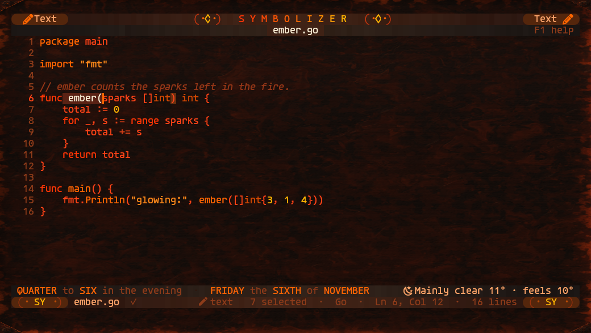
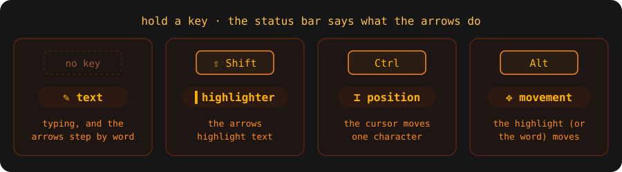
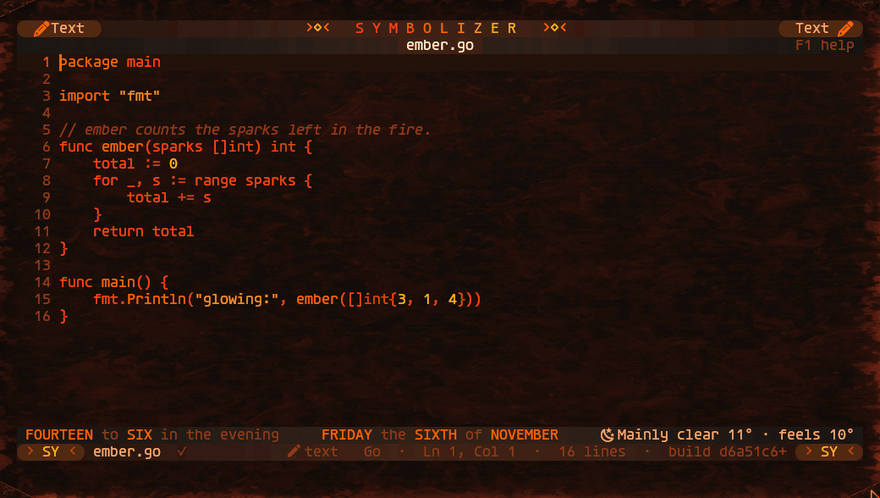
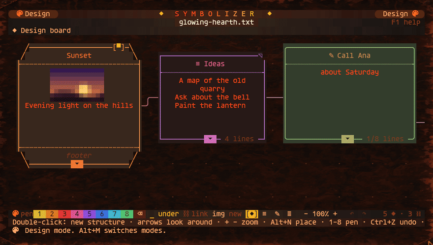
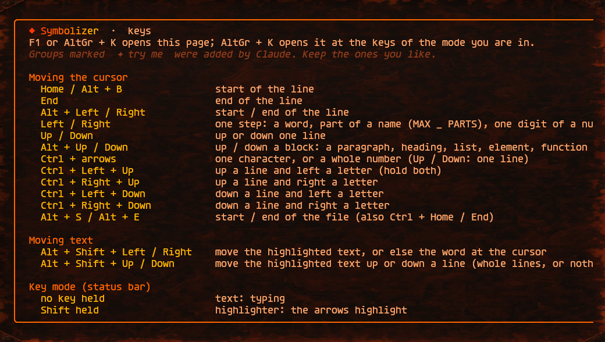

<div align="center">



<br>


**A text editor for the terminal, in the Emberistal theme.**
<br>
Embers on charcoal. It saves by itself. Every key is meant for your hands.

[Install](#-install) · [Key modes](#-key-modes) · [File manager](#-file-manager) · [Themes](#-colour-themes) · [Diary](#-diary) · [Design](#-design-mode) · [Every key](#-every-key)

<br>



</div>

<br>

## ✦ What it is

- **A calm editor.** The text sits in a centred column. The bars glow a little warmer in the middle.
- **Nothing to lose.** Every change saves itself a moment later. Text with no name is kept as a **session**.
- **Keys that say what they do.** Hold Shift, Ctrl or Alt and the status bar tells you what the arrows will do.
- **More than one kind of work.** Text, Diary and Design work today. Slides, Book and Draw are on the way.
- **Design mode.** A board made of text: octagons with pictures and six layouts, pages, notes, cabinets and drawers, links and a highlighter pen. Drag files onto it, delete anything, undo and redo, and move around it all by keyboard. Fast with thousands of elements. [See it below](#-design-mode).

## ✦ Install

You need **Go 1.27** or newer.

```sh
git clone https://github.com/tuniveza/symbolizer
cd symbolizer
go build -o sy .
ln -s "$PWD/sy" ~/.local/bin/sy     # so `sy` works from anywhere
```

For pictures in Design mode in formats other than PNG, JPEG and GIF, install **ImageMagick** (`rsvg-convert` and `ffmpeg` help too).

It runs in any terminal. It looks its best in **[kitty](https://sw.kovidgoyal.net/kitty/)** with a **Nerd Font**: kitty tells Symbolizer when a key goes up, so held keys work exactly.

## ✦ Start

```text
sy                 open again what was open last time: the files, the project, where you were
sy --new           carry on with today's session (a draft with no name)
sy notes.txt       open (or create) notes.txt
sy notes.txt +42   open notes.txt at line 42
sy ~/projects/web  open a folder as a project, with the file manager
sy -t ~/notes      open every text file in a folder and its folders as tabs
sy diary           Diary mode
sy design          Design mode   (also: slide, book, draw)
sy --keys          show what each key does
sy --version       show the version and build number (the status bar shows the build too)
```

Inside, press **F1** for every key. **Alt + Q** quits. Everything is already saved.

<br>

## ✦ Key modes

<div align="center">

</div>

<br>

| Hold | Mode | The arrows… |
|:---:|:---|:---|
| nothing | ✎ **text** | step by word: a word, part of a name (`MAX` `_` `PARTS`), one digit of a number (`1` `0`, `3` `.` `1` `4`), a bracket, an operator like `+=` |
| **Shift** | ▍ **highlighter** | highlight, one step at a time (Ctrl + Shift: one character) |
| **Ctrl** | ⌶ **position** | move the cursor one character, or past a whole number. Hold two arrows at once to go diagonally |
| **Alt** | ↔ **line** | Left / Right go to the start / end of the line; Up / Down go a block up / down |
| **Alt + Shift** | ✥ **movement** | move the highlighted text. Nothing highlighted: the word swaps places with its neighbour, and Up / Down move the whole line |

<div align="center">

<br>
<sub>Arrows step a word · Ctrl a letter · Alt jumps to the line's end and start · Alt + Shift + Right / Left indent and dedent · Shift highlights · Alt + Shift moves the highlight up a line and back · then the whole line moves</sub>
</div>

<br>

## ✦ File manager

A box that floats over the text, with an icon for each kind of file.
**Type letters** to find a file anywhere in the project.

| Keys | What it does |
|:---|:---|
| **Alt + O**, **AltGr + O** (ø), or tap **AltGr** twice | open the file manager |
| **Alt + E**, **AltGr + E**, or **Esc** | close it |
| **Enter** | open a file, or open / close a folder |
| **Right** | open a file. On a folder, **Right** once opens it here in the file manager; **Right twice** opens it as a project: every file in it and its folders as tabs (up to 50; files over 8 MB are left out) |
| **Left** straight after | undo it: the project's tabs close and the file manager is back where it was |
| **Left twice** on the project's folder | close the project. Only one project is open at a time, so close it before opening another |
| **Shift + Right** twice | the same, but only text with something in it: no pictures, sound, video, subtitles or empty files |
| **Shift + Enter** | open every text file in that folder and its folders as a project: web pages, scripts and other code first, JSON and lock files last |
| **AltGr + P** (þ) or **Alt + P** | make the chosen folder the project |
| **Ctrl + N** · **F7** · **F2** · **Del** | new file · new folder · rename · move to the Trash |

<div align="center">

</div>

<br>

## ✦ sy term

**ŧ** (Right Alt + T) opens a real kitty terminal in a pane under the editor, in the same folder.
Press it again, in the editor or in the terminal, to hide it. Hidden only means out of sight: whatever runs there keeps going, and it comes back at the same size.
**Alt + Tab** goes between the editor and the terminal, from the terminal or from Design mode (in Text mode Alt + Tab stays tab switch mode). **Alt + R** starts resizing: each arrow then moves the line between the panes that way (Up moves it up), and any other key stops (in Design mode and the terminal; in Text mode Alt + R stays Emmet's remove tag).
**¢** (Right Alt + C) in the terminal closes just that pane. It needs kitty with `sy_term.py` and its keys in `panes.conf`.

<br>

## ✦ Colour themes

**Alt + T** (or **µ**, Right Alt + M) shows six themes. The arrows show each one on the real text right away.
**Enter** keeps it. **Esc** puts the old one back. Only Symbolizer changes, never the rest of the desktop.

<div align="center">

<br>
<sub>Emberistal · Emberline · Molten · Ash · Cinder · Daybreak</sub>
</div>

<br>

## ✦ Diary

`sy diary` (or **Alt + M** → Diary). Each day is a chapter, and each chapter holds pages.
Pages are plain text files: `~/.local/share/symbolizer/diary/2026-10-28/001.txt`.

| Keys | What it does |
|:---|:---|
| **Left / Right** | previous / next page (on into the day before or after) |
| **Up / Down** | previous / next day |
| **Alt + N** or AltGr + N (”) | a new page for today, open to write on |
| **Alt + A** or AltGr + A (æ) | every page at once. Enter shows the chosen page |
| **Enter** / **Esc** | write on the page / back to the pages |

<div align="center">

</div>

<br>

## ✦ Design mode

`sy design` (or **Alt + M** → Design). A board made of text that zooms and moves.
Everything on it is drawn with letters, kept in `~/.local/share/symbolizer/design/`: `board.json` says what is on the board, each structure has its own file in `parts/`, and the ink is in `marks.json`. A save writes only what changed, so a large project stays quick to save.

- **Octagons**, or shapes (double-click the board, or **Alt + N**, **S**): a header, text and a footer. Drag to move, the ◢ corner resizes.
- **Pictures** of any format go into an octagon: **img** on the toolbar and a file name, or drop the file on the terminal. They are drawn with half-blocks.
- **Drag and drop:** in kitty (0.47 or later), drag files from your file manager onto the board. What is under the pointer lights up (a ✚ shows on the empty board), and each file goes where you let go: a picture into the octagon under it, or a new octagon there; a text file into the page or note under it, into the cabinet as a page, or a new page there. Several files land side by side. Dragged text becomes a page. Other terminals paste dropped files as their paths, and sy puts those in too, one file or several.
- **Layouts:** the icon on an octagon's top edge shows its layout. Click it (or press **AltGr + L**) for the next one: `¶` text · `▀` picture above · `◧` left · `◨` right · `■` picture only · `‖` two columns.
- **Pages** (**Alt + N**, **P**) hold text of any length and scroll. **Notes** (**Alt + N**, **N**) hold one page. Both take only text and text-like media, and both have a title and a footer.
- **Cabinets** (**Alt + N**, **C**) are a cupboard with two doors. Click the doors (or press **Tab** with it chosen) to open them; they swing open inside its frame over a few frames, and the cabinet keeps its size. Drawers slide open and shut the same way. Behind them is a shelf for each kind: pages, books, slides, notes and drawings. Drop a page or note on a cabinet to put it on its shelf. Click a thing on a shelf to take it out; **+N ▸** shows the rest of a shelf; **+** makes a new one. The last row brings in your **Diary** pages and the files open in **Text** mode. Click a door to shut it.
- **Drawers** (**Alt + N**, **D**) are a unit of one or more drawers stacked under its name. Press **]** for one more drawer and **[** for one fewer (up to 12), or click **[+]** and **[−]** on its bottom edge when it is chosen. Each drawer is a box of its own: a front with a metal bar handle, its number and how many things it holds. Each drawer has its own colour and texture (wood, brushed metal, linen, paint or marble), different from its neighbours. With the unit chosen, press **C** to change the colour of the open drawer and **Shift + C** to change its texture, or click the dot and the swatch at the right end of a drawer's front. Click a drawer's front to pull out just that drawer; its tray slides down out of the front, over a few frames. **Space** or **Tab** pulls out the next drawer and pushes in the one that was out (**Shift + Tab**: the one before). Inside, each thing is small, with one label. Drop anything on a drawer to put it in that drawer; click a thing to take it out. With fewer drawers, what was in the drawers that go moves into the new last one. Undo brings back a drawer count; pulling drawers out is not a step.
- **Boards** (**Alt + N**, **B**) are pinboards. Drop a page, note or shape on one and it is pinned where you let go, drawn as a card with its title and the first lines of its text, and a pin. A turned or skewed pin gets a fine dotted outline in its turned shape, its words kept upright and readable. A shape with a picture shows the picture filling its whole frame, turned with the pin. Click a pin to open it full size (**Esc** pins it back). Drag a pin to move it. **Tab** chooses a pin; then **R** turns it, **S** scales it, **W** / **H** stretch it, **K** / **J** skew it, **F** / **V** flip it, **Alt + arrows** move it, and **T** lets you type its transform, like `rotate 30 scale 1.5 skew 0.2`. **X X** takes it off. **Shift** with a letter goes the other way.
- **Boxes** (**Alt + N**, **O**) hold things on three layers: top, middle and bottom. It looks like an open box seen from a little above: a lit rim, inner walls that get darker toward the floor, and the near wall along its bottom. The bottom layer is drawn smaller and darker, deeper in the box; the top layer is brightest, things overlap, and each layer casts a shadow on the one under it. Drop anything on a box to put it in, on the top layer, where you let go. Click a thing to choose it; drag it to take it out. **Tab** chooses the next thing. **PgUp** / **PgDn** move the chosen thing up or down a layer, and **Alt + arrows** move it inside the box. With no thing chosen, **PgUp** / **PgDn** look at one layer: it is lit, and the layers above it go see-through, so you can click what is under them (or click a layer's name on the bottom edge). **Space** opens or shuts the lid; shut, the lid shows the box's name and how many things it holds. **D** (or the **[◇]** on its top edge) changes its design, each with its own shape: a cardboard box with flaps, a wooden crate, a metal tin, a gift box with a ribbon and bow, a round hat box and a hexagonal box.
- **Space** on a container (chosen, or with the mouse over it) opens it or shuts it: a cabinet's doors, a drawer unit's next drawer, a rack's first thing, a board's chosen pin, a box's lid.
- **Choosing several:** **Space** on a structure with a name plate (or with the mouse over one) chooses its whole group. **Ctrl + drag** on the empty board draws a shaded box and chooses everything it touches; **Ctrl + click** chooses one more, or one less. Then drag one of them (or **Alt + arrows**) to move them all; **X X** deletes them; **Esc** lets go.
- **Zooming** in or out, everything keeps its shape and its place, so things set close together stay close. Zoomed in, only the structures grow: every gap between them stays its real size at every zoom, and things lined up on the board stay lined up. A board too tall for the screen is drawn shorter, and what is beside it and under it closes up. Zoomed out, gaps get smaller but never close, and containers still show what they hold: a drawer's things get smaller, a rack drops its shelf lines, a cabinet drops its empty shelves, and a board's pins shrink together so every pin stays inside the board. Dragged, a structure stays exactly under the mouse at every zoom, also next to its neighbours, and it snaps beside them at the same distance on the screen. Only what still cannot fit becomes **+N more** (a click on it zooms to 100%). Zoomed in, they fill out instead of leaving empty space: a rack's shelves get taller, a drawer's things get bigger, a cabinet's shelves spread apart.
- **Old boards:** drawers used to hang under every structure; an old board gets each as a drawer of its own, beside its structure and linked to it.
- **Racks** (**Alt + N**, **R**) are a stack of anything, a row each with its icon and name, each on a shelf of its own. Click a row and that structure opens inside the rack, under its row, as wide as the rack (the rack grows down to hold it). While one is open, **Tab** opens the rack's next one and **Shift + Tab** the one before (round from the last to the first). Click its row again, tap **Alt** twice, or click the board to put it back in its place. Drag it to take it out of the rack.
- **Labels:** **Alt + L** turns label mode on. On the chosen structure, **L** gives it a label and goes round the styles (icon + title, title + icon, icon, title, none), **C** its colour, **I** its icon (symbols, then the pictures in `design/images`, drawn small), **T** its own words. **G** gives it a **name plate**: everything with the same name is a group. To name several at once, press **Shift + G**: click each structure (or drag a box round them on the empty board) to pick it, then press **Enter** and type one name plate for them all. **AltGr + P** lists the name plates and what has each. **Alt** tapped twice leaves label mode.
- **Links** (**⛓ link** on the toolbar), a **highlighter pen** with 8 colours (**1–8**; the rubber is **⌫** on the toolbar), and the wheel zooms, toward the pointer (**Shift + wheel** scrolls a chosen page). All text in Design mode is centred, the bars above and below the board too.
- **Top bar:** over the board, it names the board and what is chosen.
- **Mini map:** **AltGr + M** shows the whole board in a corner: each structure in its own outline (an octagon's cut corners, a note's round ones, a page's folded corner) and colour, with its symbol and title; the map takes the board's own shape; links as dotted lines, a frame for what the screen shows. Press it again for the next corner, and once more after the last to hide it.
- **3D room:** **Ctrl + F** goes into 3D, and **Ctrl + F** again or **Esc** comes back to the flat board, exactly as it was. 3D is a **first-person camera** and nothing else: **move the mouse** to look round (no button needed; the camera turns the moment the mouse moves, by exactly as much, with no smoothing to lag behind; in kitty the mouse is followed to the pixel; resting the mouse at the window's edge keeps turning that way; the **arrows** look round too), **W A S D** to move (W and S go the way you look, up and down too), **Q** and **E** to move straight up and down, and **Shift** to move faster. Under Hyprland the **mouse pointer is hidden** in 3D (shown again on the flat board, in another window, and when sy ends, even if it is killed), and once it goes a quarter of the window from the middle it is **put back in the middle**, as in a game, so mouse look never meets the window's edge; other desktops keep the pointer, as a terminal cannot hide it. While the room is in 3D, **soft lounge music** plays (a deep bass groove, electric-piano chords and brushed drums, about 43 seconds round) over **quiet office sounds** (air conditioning, far-off voices, typing, now and then a page or a mug); all of it is made by sy itself, played through `pw-play`, `paplay` or `aplay` (nothing happens without one), and it fades out on the flat board, outside design mode and when sy ends. **M** turns it off and on for the session; `SY_3D_SOUND=0` turns it off for good. There is no turning, tilting, zooming or panning of the room. **Whatever is in the middle of the camera is the chosen structure**, marked by a small cross, so keys act on it as on the flat board; on the empty room nothing is chosen. **The cross is the pointer**: clicks, drags, Shift + wheel, Space and dropped files act where the cross is, not where the mouse is, and a drag turns the camera and carries the thing along under the cross. **Alt + N** places the new structure **centred on the cross**: on the wall, a layer out in front of the structure the cross is on, or out in the room where the cross meets the floor or a wall; where its spot is taken it goes on the first free layer in front, never aside. Pasting puts things where the cross is. **Layers:** every structure stands on a layer, 0 on the wall and each one further out into the room; structures on the same layer share it, and **Shift + =** brings the chosen one a layer out, **Shift + −** takes it a layer back (on the flat board layers do not show). The wall behind a structure out on a layer is drawn without it, so its words never show twice. **3D always shows the board at 100%**, whatever the flat board's zoom: going into 3D the camera stands as far back as that zoom showed, and the flat board's zoom comes back after; in 3D **=** and **−** zoom the camera's **lens** and **0** sets it back. Resizing the window or zooming the terminal's font keeps the camera on the same spot, and the mouse does not jump after it. The camera never turns by itself and cannot walk out of the room; a structure far out on a layer does not push the start view back. The camera starts square to the wall, exactly where the flat board was, and the structures come out of the wall as you look away or move, so going into 3D has no jump. The board is the back wall of a closed room: papered walls with a dado rail and skirting board, a wooden floor and a plaster ceiling. **T** picks the next finish for the walls (paper, brick, wood panels, concrete, tiles, trellis paper, felt panels) and **Shift + T** the one before; **F** picks the next floor (planks, parquet in a herringbone, carpet tiles, polished concrete, marble squares, oak, slate) and **Shift + F** the one before. The choice is kept with the board (it is not an undo step), and every finish stays still on the wall as the camera moves, fading its fine detail far off instead of flickering. Every structure is a block on the wall: paper thin, shapes deeper, cabinets, drawer units and racks deepest. A box is an open box with its things inside; a cabinet has shelves and two doors on hinges (click a door, or **Space**). A lamp at the front left lights the room, and the blocks cast soft shadows. In kitty the room is a sharp picture at the screen's own resolution (about 120 to 180 pictures a second at any window size: a picture waits until kitty has taken in the last, so they never queue up, and while the camera moves a big window's picture has fewer pixels, sharp again a moment after it stops; `SY_3D_TRACE=file` writes its timings), and each page, note, slide and shape is a clean card with its words painted on it in the terminal's font, so they turn and shrink with the card. **Every structure's words are painted** the same way: cabinets, drawer units, racks, boards, boxes and what is in them, labels and name plates, on layers too. Icons the terminal's font lacks (⊞ ✎ ≣ ⇣ and the like) come from a font that has them, as kitty finds it, and the thin block letters (▏ ▕ ▁ …) are drawn as their exact shapes. Words stay steady at any distance, angle and lens: each letter blends between its sharper and softer copies as it shrinks, and once too small to read it fades into a soft tint of its colour instead of flickering; the wall's picture blends the same way, and box lines thin smoothly. A board's **pin turned at an angle** (or skewed) is a card of its own in front of the board with its words turned with it, whole (the flat board keeps such words upright); a click on it acts on the pin as on the flat board. Other terminals draw the room in letters (shape letters with the **Sy Geometry** font from `sy --font`, else box lines and quarter blocks); `SY_3D_PIXELS=0` or `=1` and `SY_3D_FONT=0` or `=1` turn the picture and the shape letters off or on. The room works like the flat board, all but the camera: put the cross on a drawer and click to pull it out, on a box's lid to open it, on a title and click twice to write it, and drag things to move them; **Tab**, **Alt + arrows**, **Alt + N**, pasting and dropping files do what they do on the flat board, and the board under the room never scrolls. **Esc** (or Alt tapped twice) stops writing first, then leaves a mode as on the flat board (Alt + N, several chosen, link, label, group, pen, a pin, a box's layer), then goes back to the flat board.
- **Alt tapped twice** is Esc in Design mode: it stops writing, leaves link mode, puts the pen down, or lets go of the chosen structure.
- **Snapping:** a structure moved near another snaps a small gap away from the closest one (2 columns beside it, 1 row above or below), by mouse or by **Alt + arrows**. By keys it stops at the gap: pressing on toward the other one does nothing, but it can slide along it or go back.
- **By keyboard:** an **arrow** jumps the view to the closest structure that way, centres it and chooses it (held: on to the next one; nothing that way: a step). **E** writes in the chosen structure's text. Holding **Space**, the arrows move the view freely a step at a time; let go of Space and the view snaps to the structure nearest the middle. **Shift + arrows** move the view freely (held, it glides on at once with no pause; hold two, like **Up + Right**, to go diagonally), and the structure nearest the middle of the screen is chosen as you go. **Tab** writes in the chosen one and steps through its parts: header, text, footer, and the view moves to each one (**Shift + Tab** back; on a cabinet, the next stack). An **arrow** stops writing and does its usual work: nothing in Design mode needs **Esc**. **Alt + arrows** move the chosen structure (**Alt + Shift**: further; two held: diagonally). **+** and **−** zoom around the chosen structure, which stays in the middle (the keypad's too), **0** goes back to 100%. **Alt + N**, then **P**, **N**, **C** or **S**, places a page, note, cabinet or shape in the middle of the screen. **Alt + L** changes a shape's layout. Those are all of Design mode's keys; the rest is on the toolbar and the mouse.
- **Structures fit what they hold:** while you write, a structure grows taller (never wider) so all its words show, and the view follows the typing. It stops a gap above a structure under it (unless you made it reach further yourself), and at the screen's height; a page scrolls beyond that. No structure is ever drawn taller than the screen, at any zoom: a taller one is drawn to fit, narrower by as much so it keeps its shape (its text scrolls, its picture shrinks), and keeps its own size.
- **AltGr + K** shows every keyboard shortcut, opened at the keys of the mode you are in. Press it again (or **Esc**) to close.
- **Deleting:** everything can go. Click a structure and its red **✕** (or press **X** twice, quickly). Click a link's line, then **X X**. A drawer or cabinet row has its own **✕**, and so does a chosen picture (it takes out just the picture). A structure that holds things asks first.
- **Undo and redo:** **Ctrl + Z** undoes any change (a move, a resize, words, a deletion, a link, ink) and **Ctrl + Y** (or **Ctrl + Shift + Z**) does it again; **↶ ↷** on the toolbar too. Writing in one part is one step, a drag is one step, and moving or zooming the board is not a step. Up to 100 steps, until you quit.
- **Big boards stay smooth:** only what is on the screen is drawn, each structure is drawn once and then moved (and kept at the last few zoom sizes), pictures are laid in as cells, and the board is saved in the background a moment after a change. With 5,000 structures, 2,000 links and 20,000 ink marks, panning, clicking, dragging, typing and zooming each take 2–3 ms a frame.

<div align="center">

<br>
<sub>A picture in an octagon (img) · its layout toggle · Alt + N places a cabinet, a page, a note · a page filed in it · a note's drawer · the page moves from the cabinet into the drawer</sub>
</div>

<br>

<div align="center">

<br>
<sub>Arrows move the view and choose · two held: diagonally · Tab writes and the page grows to fit · Alt + arrows move it · X X deletes, Ctrl+Z / Ctrl+Y · Alt + L layouts · Alt + N, S a shape · − + zoom · AltGr + K: the keys</sub>
</div>

<br>

<div align="center">

<br>
<sub>A rack's row opens inside the rack · drag it out, Ctrl+Z · AltGr + M: the mini map in true outlines · Shift + G: click or box to pick, Enter names the group · AltGr + P: the groups</sub>
</div>

<br>

<div align="center">

<br>
<sub>Space opens and shuts a cabinet · a drawer unit of three drawers, each its own colour and texture, each pulled out by itself · a thing dragged into the third drawer · ] adds a drawer, Tab the next one · on a board, Tab chooses a pin, R turns it</sub>
</div>

<br>

## ✦ Web files: Emmet and auto-correct

In HTML, CSS, SCSS, Sass, Stylus, LESS, JSX / TSX and XML files, Symbolizer speaks [Emmet](https://emmet.io).

- **Tab** expands the abbreviation before the cursor: `ul>li.item$*3`, `!` (a whole page: on an empty file `html`, `html:` and `html:5` give it too, even in a new tab or a `.txt`), `a:link`, `p*2>lorem10`; in CSS `m10-20`, `d:f`, `c#f`, `m10+p5`. Tab again jumps to the next empty place. A plain word that is not an abbreviation still gets a real Tab.
- **Ctrl + E** expands any word. With text highlighted, it **wraps** it: `ul>li*` puts each line in its own `li`.
- **Alt + W** lists every Emmet action: highlight the tag around or inside, go to the matching tag, remove, split / join and update tags, next empty place, select item, work out a sum, number up / down, image size, comments.
- **Tags close themselves:** type `<div>` and `</div>` appears after the cursor. Rename one tag and its partner follows.
- **CSS auto-correct:** typing `;` or `:` fixes slips: `colour` → `color`, `dispaly: flx` → `display: flex`, `10xp` → `10px`.
- **Path auto-correct:** finish a path in `src`, `href`, `url()`, `@import` or a JS `import` and a path to no file is fixed to the one it meant (`Images/Logo.PNG` → `images/logo.png`). **Alt + P** lists the files that fit. **Ctrl + Z** takes back any auto-correct.

## ✦ Brackets and suggestions

In code files (not plain text or Markdown):

- **Brackets and quotes close themselves.** Type `(` and `)` appears after the cursor. Type `)` in front of it and the cursor steps over it. Backspace in an empty `()` deletes both. Highlight text and type `(` to wrap it.
- **A list of suggestions** shows while you type a word: CSS properties (3 letters or more), the values a property takes, pseudo-classes, HTML tags after `<`, and words already in the file. **Tab** takes the chosen one, **Up / Down** choose, **Esc** closes the list.
- **CSS:** choosing a property gives `display: ;` and opens its values. Typing `color:` adds the `;` after the cursor.
- Short Emmet words (`fl`, `ta`, `m10`) show no list, so Tab still expands them.
- **Unit hints (CSS):** a dim shadow shows the recommended unit as you type. `font-size: 1` shows `rem`; an empty `height:` shows `auto`. **Tab** takes it. The message line says why.

## ✦ Learn

Press **AltGr + L** (ł) for a card with the recommended way to write the file's language today.

- **It opens at what the cursor is on.** On `16px` it opens the Units section at `px`. On `?.` in JavaScript it opens that line.
- **The card follows the file's ending:** `.css` → CSS, `.go` → Go, `.md` → Markdown. **Tab** shows another language.
- **Each line says three things:** what to use, what it is (from the specification), and what it is like in the real world.
- **The layout never moves:** language, section, the list of lines, then the chosen line in full. **Up / Down** choose a line, **Left / Right** a section, **Esc** closes.
- Cards: CSS, HTML, JavaScript, TypeScript, Markdown, JSON / YAML / TOML, XML / SVG, Go, Python, Rust, C / C++, Java, Kotlin, C#, PHP, SQL, Lua and Shell. Every fact was checked against the language's specification; each card names the ones it used.

## ✦ Saving and sessions

- Everything saves by itself a moment after each change.
- Text with no name is a **session**, kept in `~/.local/share/symbolizer/sessions`. Its tab gets a made-up file name from its text (first function, heading or words, like `tidy_room.py`), or an ember name like `molten-lantern.txt`.
- `sy` carries on with the session changed in the last 24 hours. After 24 hours with no change, `sy` starts a new one. The old one waits in the **Alt + L** list.
- **Ctrl + S** on a session asks for a name. The ending comes from what the text looks like: `hello` becomes `hello.py`, `hello.c` …
- If another program changes an open file (git, a formatter, another editor), the new text comes in by itself within a second. Only the changed lines change. **Ctrl + Z** takes it back.
- If you have changes not saved yet at that moment, saving pauses instead of writing over either side.

## ✦ Every key

Press **F1** inside Symbolizer for the full, scrollable list, or **AltGr + K** to open it at the keys of the mode you are in.

<div align="center">

</div>

<details>
<summary><b>The whole list, here</b></summary>

<br>

| Keys | What it does |
|:---|:---|
| Left / Right | cursor one step: a word, part of a name, one digit of a number (1 0, 3 . 1 4), bracket, or operator |
| Up / Down | up / down a line |
| Alt + Up / Down | up / down a block, by the file's language: Markdown headings, lists and code fences; HTML elements; Python blocks; code from a { ( [ to the bracket that closes it; plain paragraphs. On a line that opens a bracket or tag, Down goes to its closing line and Up goes back |
| Home / Alt + B · End | start / end of the line |
| Alt + Left / Right | start / end of the line |
| Alt + S / Alt + E | start / end of the file (also Ctrl + Home / End) |
| Ctrl + arrows | cursor one character, or past a whole number (Up / Down: one line) |
| Ctrl + Left + Up (hold both), and the other 3 pairs | one line and one letter at once |
| Shift + Left / Right | highlight one step |
| Ctrl + Shift + arrows | highlight one character, or a whole number (Up / Down: one line) |
| Alt + Shift + Left / Right | dedent / indent the line, or every highlighted line |
| Alt + Shift + Up / Down | move the highlighted text a line, in its column; whole lines or nothing highlighted: the line moves |
| Ctrl + C · Ctrl + X · Ctrl + V / Ctrl + P | copy · cut · paste |
| Ctrl + Z · Ctrl + Y | undo · redo |
| Ctrl + F · Ctrl + R · Ctrl + G | find · replace · go to line |
| Ctrl + D · Ctrl + K or Alt + D · Ctrl + / | duplicate · delete line · comment |
| Alt + B | delete the block the cursor is in: from a { ( [ to the bracket that closes it (or an HTML element, a Python block, a paragraph) |
| Ctrl + S or ß (Right Alt + S) | save now (a session is asked for a name) |
| Alt + A | save under a new name |
| Alt + L | load: sessions, or this file again from disk |
| Alt + N / Alt + C | new file in a new tab / close this file |
| Alt + 1 … 9 · Ctrl + PgUp / PgDn | go to open file 1 … 9 · previous / next |
| Alt + Tab | tab mode: the tabs open out into rows. Left / Right or A / D = the file before / after, Up / Down or W / S = the row above / below, Enter (once or twice), Down twice quickly or a tap of Alt keeps it, Esc goes back |
| Tab · Shift + Tab | a real Tab (indent) · un-indent (web files: Tab expands an Emmet abbreviation first) |
| Ctrl + E · Alt + W | Emmet: expand (highlighted: wrap) · every web action |
| Alt + U / D · Alt + G · Alt + R · Alt + K · Alt + Y | tag around / inside · matching tag · remove · split / join · update |
| Alt + . / , · Alt + ] / [ · Alt + X · Alt + = / - · Alt + I · Alt + P | next / previous empty place · next / previous item · sum · number up / down · image size · file paths |
| Alt + J | centre the lines of this file, or put them back on the left |
| Alt + Z | word wrap on / off: long lines carry on in the rows under them, broken between words and indented like their line. On to start with; remembered |
| Alt + T or µ | colour themes |
| ŧ (Right Alt + T) | sy term: show or hide a kitty terminal under the editor |
| Alt + Tab (Design mode, sy term) | the other split: the editor ↔ sy term (a kitty map in `~/.config/kitty/panes.conf`) |
| Alt + R, then arrows | resize mode: each arrow moves the line between the panes that way; any other key stops (not in Text mode: there it is Emmet's remove tag) |
| Alt + M | switch modes: Text, Design, Slides, Diary, Book, Draw |
| Design: Alt + N, then P · N · S · C · D · R · B · O | new page · note · shape · cabinet · drawer · rack · board · box (F1 in Design mode lists all its keys) |
| Design: D · PgUp · PgDn (a box chosen) | the box's next design · its chosen thing a layer up · down (none chosen: look at one layer) |
| Design: Space · Ctrl + drag · Ctrl + click | open or shut a container, or choose a whole group · everything a box touches · one more |
| Design: Alt + L, then L · C · I · T · G | label mode: label style · colour · icon · words · name plate |
| Design: Shift + G | group mode: pick structures (click, drag a box, or G), Enter gives them one name plate |
| Design: AltGr + P | the list of name plates and what has each |
| Design: AltGr + L | the chosen shape's next layout |
| Design: X X or ✕ | delete the chosen structure or link |
| Design: img on the toolbar | a picture (or text file) for the chosen structure: type its path |
| Design: Ctrl + Z · Ctrl + Y | undo · redo any change on the board (also Ctrl + Shift + Z, and ↶ ↷ on the toolbar) |
| Design: arrows · Shift + arrows · Tab | jump to the closest structure that way · move the view freely · write in the chosen structure, then its next part |
| Design: Alt + arrows · + − 0 | move the chosen structure · zoom the view in, out, back to 100% |
| Design: Ctrl + F | 3D, first person: mouse or arrows look round, W A S D move, Q E up and down, Shift faster, = − 0 lens, Shift + = / Shift + − a layer out / back, M music off or on; the cross in the middle is chosen and is where clicks act (the pointer is hidden under Hyprland); T / Shift + T: the walls' finish, F / Shift + F: the floor's; Ctrl + F or Esc: the flat board |
| Design: 1–8 | pen colours (rubber and over/under are on the toolbar) |
| F1 or Alt + H | every key |
| AltGr + K (ĸ) | every key, opened at the mode you are in |
| Alt + Q | quit (everything is already saved) |

</details>

<details>
<summary><b>The screen, part by part</b></summary>

<br>

- **Top panel:** SYMBOLIZER in the middle, the emblem on each side, the mode at both ends (click it to switch modes).
- **The emblem:** a small symbol mirrored round a centre, like `›◆‹`, `( · ✦ · )` or `▸◇◂`. A new one is made each time sy opens. It is lit like an ember: brightest in the middle.
- **Tab row:** the open files.
- **Central zone:** the text in a centred column; code stays left-aligned inside it. Drag the thin line on either side to make it wider or narrower. The width is remembered.
- **Info line:** the time and date in words (“TWENTY-SIX past FOUR in the afternoon”) and the weather, from [Open-Meteo](https://open-meteo.com/).
- **Status bar:** the file, saving, the key mode, the language and the cursor position.
- **Lock plate** (Hyprland, fullscreen): press Caps / Num / Scroll / Fn Lock and a small resin plate of glowing keycaps flashes up, then fades.

</details>

<details>
<summary><b>Setting up kitty, Hyprland and the mirror font</b></summary>

<br>

**kitty** keeps Ctrl + Shift + arrows for itself. These lines in `kitty.conf` hand them to Symbolizer, only while a Symbolizer window has focus:

```conf
map --when-focus-on title:Symbolizer kitty_mod+left
map --when-focus-on title:Symbolizer kitty_mod+right
map --when-focus-on title:Symbolizer kitty_mod+up
map --when-focus-on title:Symbolizer kitty_mod+down
```

**Hyprland** uses Alt + Tab to switch windows. To give it to Symbolizer, make the Alt + Tab bind check the active window first: if its title ends in “— Symbolizer”, pass the key on; otherwise switch windows as usual.

**Mirror font** (optional): the two mode icons in the top panel face each other. `python3 tools/mirror_font.py` builds a small flipped font from Agave Nerd Font and installs it. Without it, both icons face the same way.

</details>

<details>
<summary><b>Where the code is</b></summary>

<br>

| File | What it holds |
|:---|:---|
| `main.go` | start-up |
| `editor.go` | keys and commands |
| `keymode.go` | the key mode word |
| `buffer.go` · `steps.go` | the text, undo, and where word steps stop |
| `view.go` · `theme.go` · `themes.go` | drawing and colours |
| `highlight.go` · `detect.go` | syntax colours and guessing the language |
| `tree.go` · `fileview.go` | the file manager |
| `autosave.go` · `sessions.go` · `files.go` | saving, sessions and naming |
| `diary.go` · `modes.go` | Diary mode and the modes box |
| `design.go` · `design_paper.go` · `design_image.go` · `design_delete.go` · `design_undo.go` · `design_store.go` · `design_dnd.go` · `design_keys.go` | Design mode: the board · pages, notes, cabinets and drawers · pictures and layouts · deleting · undo and redo · the board on disk, in parts · drag and drop · moving around by keyboard |
| `help.go` · `keycheck.go` | the F1 page and `sy --keys` |
| `web.go` · `emmet/` | Emmet, closing tags and auto-correct in web files |
| `pairs.go` · `suggest.go` | brackets that close themselves and the suggestion list |
| `reload.go` | files another program changed come in by themselves |
| `ghost.go` · `emmet/units.go` | CSS unit hints: the dim shadow and its rules |
| `learn.go` · `learn_*.go` | the Learn box (AltGr + L) and its cards |
| `lamps.go` · `lockplate.go` | lock keys and the lock plate |

</details>

## ✦ Tests

```sh
go test ./...                              # every key and command
python3 tests/e2e.py                       # runs the real sy in a test terminal (needs: pip install pyte)
go test -run x -bench 'Design|BigBoard|Huge'  # how fast Design mode is, on large made-up projects
```

<br>

<div align="center">
<sub>Made by <a href="https://github.com/tuniveza">tuniveza</a> with Claude · Emberistal colours · ✦</sub>
</div>
