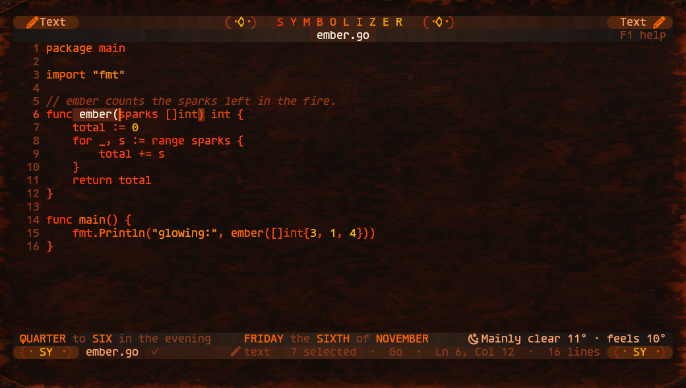
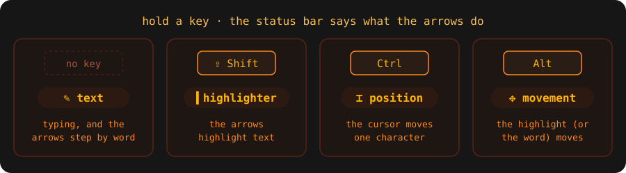
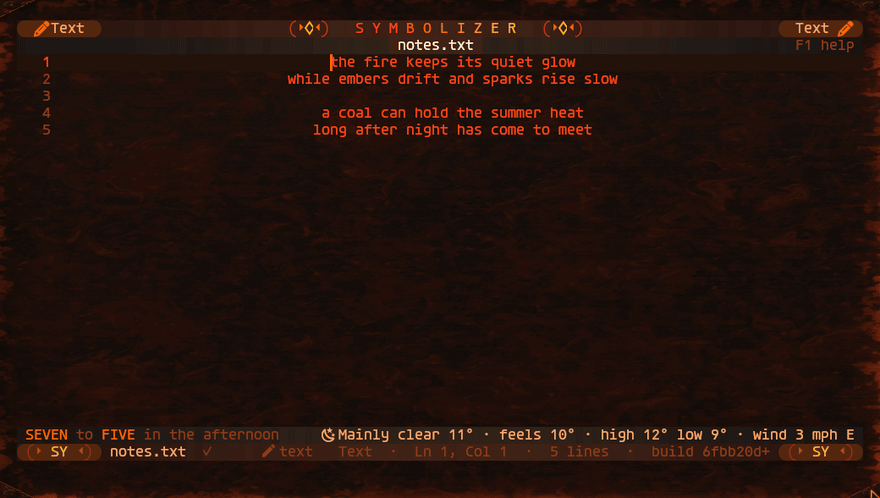
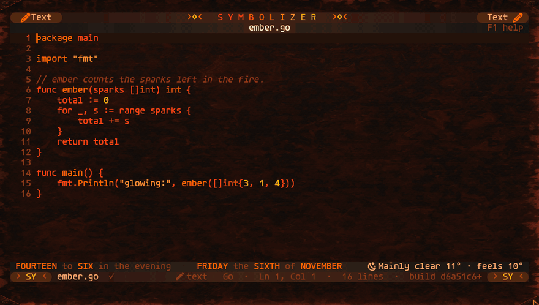
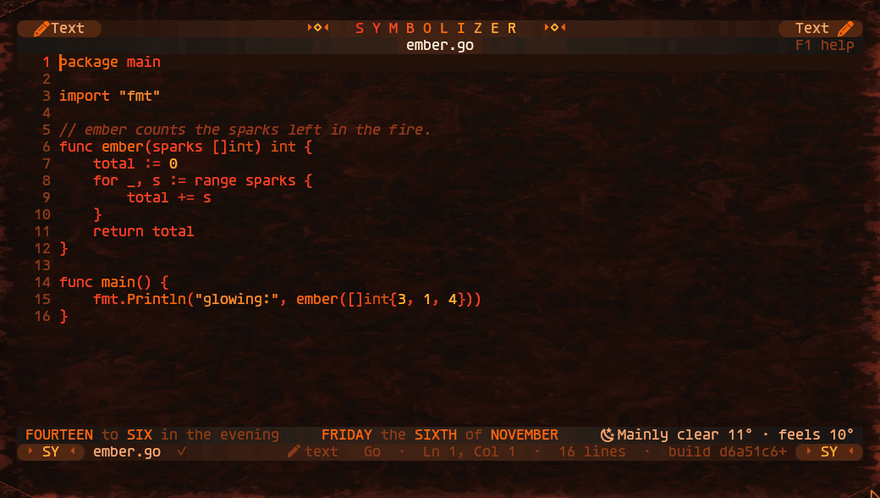
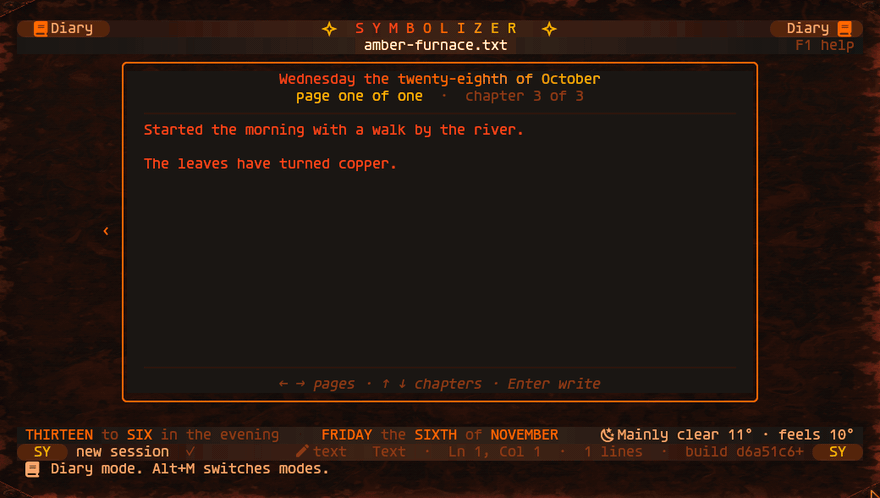
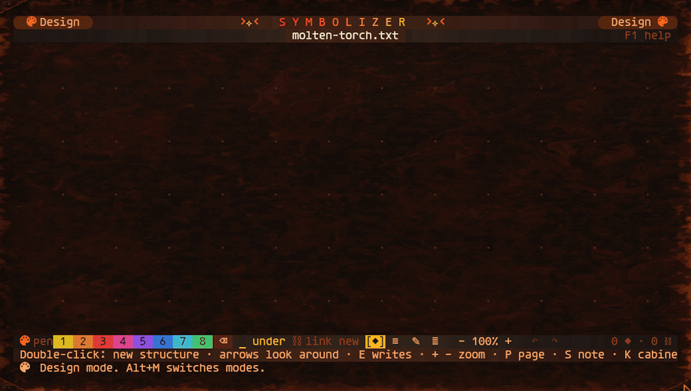
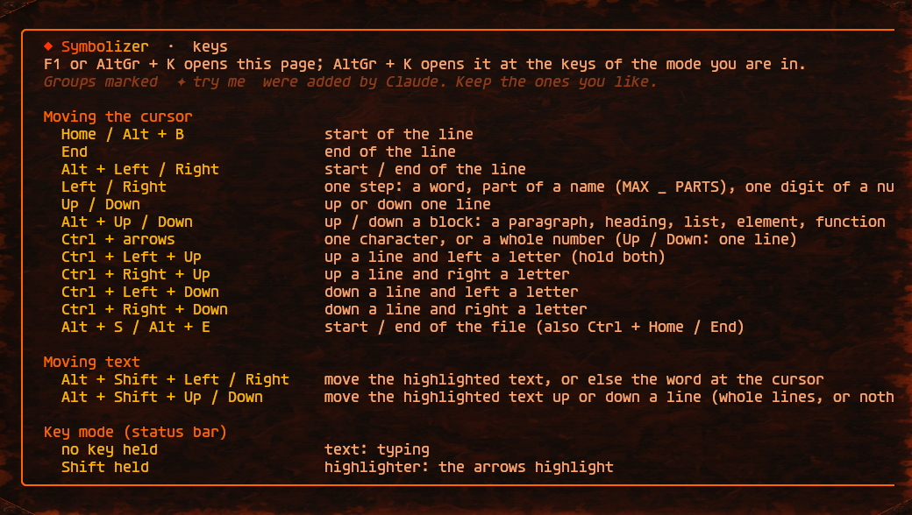

<div align="center">



<br>


**A text editor for the terminal, in the Emberistal theme.**
<br>
Embers on charcoal. It saves by itself. Every key is meant for your hands.

[Install](#-install) · [Key modes](#-key-modes) · [File manager](#-file-manager) · [Themes](#-colour-themes) · [Diary](#-diary) · [Design](#-design-mode) · [Every key](#-every-key)

<br>



</div>

<br>

## ✦ What it is

- **A calm editor.** The text sits in a centred column. The bars glow a little warmer in the middle.
- **Nothing to lose.** Every change saves itself a moment later. Text with no name is kept as a **session**.
- **Keys that say what they do.** Hold Shift, Ctrl or Alt and the status bar tells you what the arrows will do.
- **More than one kind of work.** Text, Diary and Design work today. Slides, Book and Draw are on the way.
- **Design mode.** A board made of text: octagons with pictures and six layouts, pages, notes, cabinets and drawers, links and a highlighter pen. [See it below](#-design-mode).

## ✦ Install

You need **Go 1.27** or newer.

```sh
git clone https://github.com/tuniveza/symbolizer
cd symbolizer
go build -o sy .
ln -s "$PWD/sy" ~/.local/bin/sy     # so `sy` works from anywhere
```

For pictures in Design mode in formats other than PNG, JPEG and GIF, install **ImageMagick** (`rsvg-convert` and `ffmpeg` help too).

It runs in any terminal. It looks its best in **[kitty](https://sw.kovidgoyal.net/kitty/)** with a **Nerd Font**: kitty tells Symbolizer when a key goes up, so held keys work exactly.

## ✦ Start

```text
sy                 open again what was open last time: the files, the project, where you were
sy --new           carry on with today's session (a draft with no name)
sy notes.txt       open (or create) notes.txt
sy notes.txt +42   open notes.txt at line 42
sy ~/projects/web  open a folder as a project, with the file manager
sy -t ~/notes      open every text file in a folder and its folders as tabs
sy diary           Diary mode
sy design          Design mode   (also: slide, book, draw)
sy --keys          show what each key does
sy --version       show the version and build number (the status bar shows the build too)
```

Inside, press **F1** for every key. **Alt + Q** quits. Everything is already saved.

<br>

## ✦ Key modes

<div align="center">

</div>

<br>

| Hold | Mode | The arrows… |
|:---:|:---|:---|
| nothing | ✎ **text** | step by word: a word, part of a name (`MAX` `_` `PARTS`), one digit of a number (`1` `0`, `3` `.` `1` `4`), a bracket, an operator like `+=` |
| **Shift** | ▍ **highlighter** | highlight, one step at a time (Ctrl + Shift: one character) |
| **Ctrl** | ⌶ **position** | move the cursor one character, or past a whole number. Hold two arrows at once to go diagonally |
| **Alt** | ↔ **line** | Left / Right go to the start / end of the line; Up / Down go a block up / down |
| **Alt + Shift** | ✥ **movement** | move the highlighted text. Nothing highlighted: the word swaps places with its neighbour, and Up / Down move the whole line |

<div align="center">

<br>
<sub>Arrows step a word · Ctrl a letter · Alt jumps to the line's end and start · Alt + Shift carries “fire” along · Shift highlights · Alt + Shift moves the highlight up a line and back · then the whole line moves</sub>
</div>

<br>

## ✦ File manager

A box that floats over the text, with an icon for each kind of file.
**Type letters** to find a file anywhere in the project.

| Keys | What it does |
|:---|:---|
| **Alt + O**, **AltGr + O** (ø), or tap **AltGr** twice | open the file manager |
| **Alt + E**, **AltGr + E**, or **Esc** | close it |
| **Enter** | open a file, or open / close a folder |
| **Right** | open a file. On a folder, **Right** once opens it here in the file manager; **Right twice** opens it as a project: every file in it and its folders as tabs (up to 50; files over 8 MB are left out) |
| **Left** straight after | undo it: the project's tabs close and the file manager is back where it was |
| **Left twice** on the project's folder | close the project. Only one project is open at a time, so close it before opening another |
| **Shift + Right** twice | the same, but only text with something in it: no pictures, sound, video, subtitles or empty files |
| **Shift + Enter** | open every text file in that folder and its folders as a project: web pages, scripts and other code first, JSON and lock files last |
| **AltGr + P** (þ) or **Alt + P** | make the chosen folder the project |
| **Ctrl + N** · **F7** · **F2** · **Del** | new file · new folder · rename · move to the Trash |

<div align="center">

</div>

<br>

## ✦ sy term

**ŧ** (Right Alt + T) opens a real kitty terminal in a pane under the editor, in the same folder.
Press it again, in the editor or in the terminal, to hide it. Hidden only means out of sight: whatever runs there keeps going, and it comes back at the same size.
**¢** (Right Alt + C) in the terminal closes just that pane. It needs kitty with `sy_term.py` and its keys in `panes.conf`.

<br>

## ✦ Colour themes

**Alt + T** (or **µ**, Right Alt + M) shows six themes. The arrows show each one on the real text right away.
**Enter** keeps it. **Esc** puts the old one back. Only Symbolizer changes, never the rest of the desktop.

<div align="center">

<br>
<sub>Emberistal · Emberline · Molten · Ash · Cinder · Daybreak</sub>
</div>

<br>

## ✦ Diary

`sy diary` (or **Alt + M** → Diary). Each day is a chapter, and each chapter holds pages.
Pages are plain text files: `~/.local/share/symbolizer/diary/2026-10-28/001.txt`.

| Keys | What it does |
|:---|:---|
| **Left / Right** | previous / next page (on into the day before or after) |
| **Up / Down** | previous / next day |
| **Alt + N** or AltGr + N (”) | a new page for today, open to write on |
| **Alt + A** or AltGr + A (æ) | every page at once. Enter shows the chosen page |
| **Enter** / **Esc** | write on the page / back to the pages |

<div align="center">

</div>

<br>

## ✦ Design mode

`sy design` (or **Alt + M** → Design). A board made of text that zooms and moves.
Everything on it is drawn with letters, kept in `~/.local/share/symbolizer/design/board.json`.

- **Octagons** (double-click the board, or **N**): a header, text and a footer. Drag to move, the ◢ corner resizes.
- **Pictures** of any format go into an octagon: **I** and a file name, or drop the file on the terminal. They are drawn with half-blocks.
- **Layouts:** the icon on an octagon's top edge shows its layout. Click it (or **L**) for the next one: `¶` text · `▀` picture above · `◧` left · `◨` right · `■` picture only · `‖` two columns.
- **Pages** (**P**) hold text of any length and scroll. **Notes** (**S**) hold one page. Both take only text and text-like media.
- **Cabinets** (**K**) keep a stack each of pages, books, slides, notes and drawings. Drop a page or note on one to file it. Click a stack to pull it out, and drag a page back out onto the board. A cabinet can bring in your **Diary** pages and the files open in **Text** mode.
- **Drawers:** every structure has one. The **▾** on its bottom edge (or **D**) pulls it out: a small cabinet of its own.
- **Links** (**AltGr + L**), a **highlighter pen** with 8 colours (**1–8**, **E** rubber), and the wheel zooms.
- **Deleting:** everything can go. Click a structure and its red **✕** (or press **Delete**). Click a link's line, then **Delete**. A drawer or cabinet row has its own **✕**, and so does a chosen picture (**Shift + Delete** takes out just the picture). A structure that holds things asks first.
- **Undo and redo:** **Ctrl + Z** undoes any change (a move, a resize, words, a deletion, a link, ink) and **Ctrl + Y** (or **Ctrl + Shift + Z**) does it again; **↶ ↷** on the toolbar too. Writing in one part is one step, a drag is one step, and moving or zooming the board is not a step. Up to 100 steps, until you quit.
- **Big boards stay smooth:** only what is on the screen is drawn, each structure is drawn once and then moved, pictures are laid in as cells, and the board is saved in the background a moment after a change.

<div align="center">

<br>
<sub>A picture in an octagon · its layout toggle · a cabinet · a page filed in it · a note's drawer · the page moves from the cabinet into the drawer</sub>
</div>

<br>

## ✦ Web files: Emmet and auto-correct

In HTML, CSS, SCSS, Sass, Stylus, LESS, JSX / TSX and XML files, Symbolizer speaks [Emmet](https://emmet.io).

- **Tab** expands the abbreviation before the cursor: `ul>li.item$*3`, `!` (a whole page: on an empty file `html`, `html:` and `html:5` give it too, even in a new tab or a `.txt`), `a:link`, `p*2>lorem10`; in CSS `m10-20`, `d:f`, `c#f`, `m10+p5`. Tab again jumps to the next empty place. A plain word that is not an abbreviation still gets a real Tab.
- **Ctrl + E** expands any word. With text highlighted, it **wraps** it: `ul>li*` puts each line in its own `li`.
- **Alt + W** lists every Emmet action: highlight the tag around or inside, go to the matching tag, remove, split / join and update tags, next empty place, select item, work out a sum, number up / down, image size, comments.
- **Tags close themselves:** type `<div>` and `</div>` appears after the cursor. Rename one tag and its partner follows.
- **CSS auto-correct:** typing `;` or `:` fixes slips: `colour` → `color`, `dispaly: flx` → `display: flex`, `10xp` → `10px`.
- **Path auto-correct:** finish a path in `src`, `href`, `url()`, `@import` or a JS `import` and a path to no file is fixed to the one it meant (`Images/Logo.PNG` → `images/logo.png`). **Alt + P** lists the files that fit. **Ctrl + Z** takes back any auto-correct.

## ✦ Brackets and suggestions

In code files (not plain text or Markdown):

- **Brackets and quotes close themselves.** Type `(` and `)` appears after the cursor. Type `)` in front of it and the cursor steps over it. Backspace in an empty `()` deletes both. Highlight text and type `(` to wrap it.
- **A list of suggestions** shows while you type a word: CSS properties (3 letters or more), the values a property takes, pseudo-classes, HTML tags after `<`, and words already in the file. **Tab** takes the chosen one, **Up / Down** choose, **Esc** closes the list.
- **CSS:** choosing a property gives `display: ;` and opens its values. Typing `color:` adds the `;` after the cursor.
- Short Emmet words (`fl`, `ta`, `m10`) show no list, so Tab still expands them.
- **Unit hints (CSS):** a dim shadow shows the recommended unit as you type. `font-size: 1` shows `rem`; an empty `height:` shows `auto`. **Tab** takes it. The message line says why.

## ✦ Learn

Press **AltGr + L** (ł) for a card with the recommended way to write the file's language today.

- **It opens at what the cursor is on.** On `16px` it opens the Units section at `px`. On `?.` in JavaScript it opens that line.
- **The card follows the file's ending:** `.css` → CSS, `.go` → Go, `.md` → Markdown. **Tab** shows another language.
- **Each line says three things:** what to use, what it is (from the specification), and what it is like in the real world.
- **The layout never moves:** language, section, the list of lines, then the chosen line in full. **Up / Down** choose a line, **Left / Right** a section, **Esc** closes.
- Cards: CSS, HTML, JavaScript, TypeScript, Markdown, JSON / YAML / TOML, XML / SVG, Go, Python, Rust, C / C++, Java, Kotlin, C#, PHP, SQL, Lua and Shell. Every fact was checked against the language's specification; each card names the ones it used.

## ✦ Saving and sessions

- Everything saves by itself a moment after each change.
- Text with no name is a **session**, kept in `~/.local/share/symbolizer/sessions`. Its tab gets a made-up file name from its text (first function, heading or words, like `tidy_room.py`), or an ember name like `molten-lantern.txt`.
- `sy` carries on with the session changed in the last 24 hours. After 24 hours with no change, `sy` starts a new one. The old one waits in the **Alt + L** list.
- **Ctrl + S** on a session asks for a name. The ending comes from what the text looks like: `hello` becomes `hello.py`, `hello.c` …
- If another program changes an open file (git, a formatter, another editor), the new text comes in by itself within a second. Only the changed lines change. **Ctrl + Z** takes it back.
- If you have changes not saved yet at that moment, saving pauses instead of writing over either side.

## ✦ Every key

Press **F1** inside Symbolizer for the full, scrollable list.

<div align="center">

</div>

<details>
<summary><b>The whole list, here</b></summary>

<br>

| Keys | What it does |
|:---|:---|
| Left / Right | cursor one step: a word, part of a name, one digit of a number (1 0, 3 . 1 4), bracket, or operator |
| Up / Down | up / down a line |
| Alt + Up / Down | up / down a block, by the file's language: Markdown headings, lists and code fences; HTML elements; Python blocks; code from a { ( [ to the bracket that closes it; plain paragraphs. On a line that opens a bracket or tag, Down goes to its closing line and Up goes back |
| Home / Alt + B · End | start / end of the line |
| Alt + Left / Right | start / end of the line |
| Alt + S / Alt + E | start / end of the file (also Ctrl + Home / End) |
| Ctrl + arrows | cursor one character, or past a whole number (Up / Down: one line) |
| Ctrl + Left + Up (hold both), and the other 3 pairs | one line and one letter at once |
| Shift + Left / Right | highlight one step |
| Ctrl + Shift + arrows | highlight one character, or a whole number (Up / Down: one line) |
| Alt + Shift + Left / Right | move the highlighted text one letter, or swap the word with the next one |
| Alt + Shift + Up / Down | move the highlighted text a line, in its column; whole lines or nothing highlighted: the line moves |
| Ctrl + C · Ctrl + X · Ctrl + V / Ctrl + P | copy · cut · paste |
| Ctrl + Z · Ctrl + Y | undo · redo |
| Ctrl + F · Ctrl + R · Ctrl + G | find · replace · go to line |
| Ctrl + D · Ctrl + K or Alt + D · Ctrl + / | duplicate · delete line · comment |
| Alt + B | delete the block the cursor is in: from a { ( [ to the bracket that closes it (or an HTML element, a Python block, a paragraph) |
| Ctrl + S or ß (Right Alt + S) | save now (a session is asked for a name) |
| Alt + A | save under a new name |
| Alt + L | load: sessions, or this file again from disk |
| Alt + N / Alt + C | new file in a new tab / close this file |
| Alt + 1 … 9 · Ctrl + PgUp / PgDn | go to open file 1 … 9 · previous / next |
| Alt + Tab | tab mode: the tabs open out into rows. Left / Right or A / D = the file before / after, Up / Down or W / S = the row above / below, Enter (once or twice), Down twice quickly or a tap of Alt keeps it, Esc goes back |
| Tab · Shift + Tab | a real Tab (indent) · un-indent (web files: Tab expands an Emmet abbreviation first) |
| Ctrl + E · Alt + W | Emmet: expand (highlighted: wrap) · every web action |
| Alt + U / D · Alt + G · Alt + R · Alt + K · Alt + Y | tag around / inside · matching tag · remove · split / join · update |
| Alt + . / , · Alt + ] / [ · Alt + X · Alt + = / - · Alt + I · Alt + P | next / previous empty place · next / previous item · sum · number up / down · image size · file paths |
| Alt + J | centre the lines of this file, or put them back on the left |
| Alt + Z | word wrap on / off: long lines carry on in the rows under them, broken between words and indented like their line. On to start with; remembered |
| Alt + T or µ | colour themes |
| ŧ (Right Alt + T) | sy term: show or hide a kitty terminal under the editor |
| Alt + M | switch modes: Text, Design, Slides, Diary, Book, Draw |
| Design: N · P · S · K | new octagon · page · note · cabinet (F1 in Design mode lists all its keys) |
| Design: I · L · D | a picture (or text file) · next layout · pull the drawer out or put it back |
| Design: Delete or ✕ | delete the chosen structure or link (Shift + Delete: just the picture) |
| Design: Ctrl + Z · Ctrl + Y | undo · redo any change on the board (also Ctrl + Shift + Z, and ↶ ↷ on the toolbar) |
| F1 or Alt + H | every key |
| Alt + Q | quit (everything is already saved) |

</details>

<details>
<summary><b>The screen, part by part</b></summary>

<br>

- **Top panel:** SYMBOLIZER in the middle, the emblem on each side, the mode at both ends (click it to switch modes).
- **The emblem:** a small symbol mirrored round a centre, like `›◆‹`, `( · ✦ · )` or `▸◇◂`. A new one is made each time sy opens. It is lit like an ember: brightest in the middle.
- **Tab row:** the open files.
- **Central zone:** the text in a centred column; code stays left-aligned inside it. Drag the thin line on either side to make it wider or narrower. The width is remembered.
- **Info line:** the time and date in words (“TWENTY-SIX past FOUR in the afternoon”) and the weather, from [Open-Meteo](https://open-meteo.com/).
- **Status bar:** the file, saving, the key mode, the language and the cursor position.
- **Lock plate** (Hyprland, fullscreen): press Caps / Num / Scroll / Fn Lock and a small resin plate of glowing keycaps flashes up, then fades.

</details>

<details>
<summary><b>Setting up kitty, Hyprland and the mirror font</b></summary>

<br>

**kitty** keeps Ctrl + Shift + arrows for itself. These lines in `kitty.conf` hand them to Symbolizer, only while a Symbolizer window has focus:

```conf
map --when-focus-on title:Symbolizer kitty_mod+left
map --when-focus-on title:Symbolizer kitty_mod+right
map --when-focus-on title:Symbolizer kitty_mod+up
map --when-focus-on title:Symbolizer kitty_mod+down
```

**Hyprland** uses Alt + Tab to switch windows. To give it to Symbolizer, make the Alt + Tab bind check the active window first: if its title ends in “— Symbolizer”, pass the key on; otherwise switch windows as usual.

**Mirror font** (optional): the two mode icons in the top panel face each other. `python3 tools/mirror_font.py` builds a small flipped font from Agave Nerd Font and installs it. Without it, both icons face the same way.

</details>

<details>
<summary><b>Where the code is</b></summary>

<br>

| File | What it holds |
|:---|:---|
| `main.go` | start-up |
| `editor.go` | keys and commands |
| `keymode.go` | the key mode word |
| `buffer.go` · `steps.go` | the text, undo, and where word steps stop |
| `view.go` · `theme.go` · `themes.go` | drawing and colours |
| `highlight.go` · `detect.go` | syntax colours and guessing the language |
| `tree.go` · `fileview.go` | the file manager |
| `autosave.go` · `sessions.go` · `files.go` | saving, sessions and naming |
| `diary.go` · `modes.go` | Diary mode and the modes box |
| `design.go` · `design_paper.go` · `design_image.go` · `design_delete.go` · `design_undo.go` | Design mode: the board · pages, notes, cabinets and drawers · pictures and layouts · deleting · undo and redo |
| `help.go` · `keycheck.go` | the F1 page and `sy --keys` |
| `web.go` · `emmet/` | Emmet, closing tags and auto-correct in web files |
| `pairs.go` · `suggest.go` | brackets that close themselves and the suggestion list |
| `reload.go` | files another program changed come in by themselves |
| `ghost.go` · `emmet/units.go` | CSS unit hints: the dim shadow and its rules |
| `learn.go` · `learn_*.go` | the Learn box (AltGr + L) and its cards |
| `lamps.go` · `lockplate.go` | lock keys and the lock plate |

</details>

## ✦ Tests

```sh
go test ./...                              # every key and command
python3 tests/e2e.py                       # runs the real sy in a test terminal (needs: pip install pyte)
go test -run x -bench 'Design|BigBoard'    # how fast Design mode draws, on a large made-up project
```

<br>

<div align="center">
<sub>Made by <a href="https://github.com/tuniveza">tuniveza</a> with Claude · Emberistal colours · ✦</sub>
</div>
