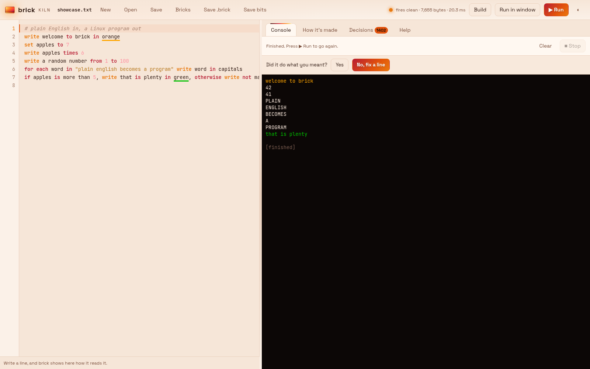
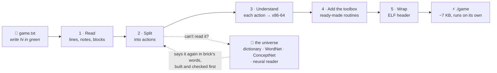

<p align="center">
  
</p>

<p align="center">
  
  
  
  
</p>

<p align="center">
  <b>You write what you want in everyday English.<br>
  brick fires it, like clay in a kiln, into a real Linux program:<br>
  a few kilobytes of x86-64 machine code that the processor runs directly.</b>
</p>

<p align="center">
  <a href="#-quick-start">Quick start</a> ·
  <a href="#-a-tour-of-the-language">The language</a> ·
  <a href="#-brick-mode-in-symbolizer">Brick mode</a> ·
  <a href="#-how-it-works">How it works</a> ·
  <a href="#-brick-teaches-itself">Learning</a> ·
  <a href="#-every-command">Commands</a>
</p>

---

## ✨ In thirty seconds

Write this in a text file called `game.txt`:

```text
write get ready, wait a random number from 1 to 5 seconds, write GO in green,
start a timer as t, wait for a key, write you took t seconds
```

Then run:

```console
$ brick game.txt
```

brick builds `./game` (a stand-alone program of about 7 KB) and runs it.
You have just written a reaction-time game in one sentence.

There is no Python inside `./game`, no C compiler was used, and no C library is linked in.
brick wrote every byte of it: the machine code, the data and the ELF header that Linux needs.

```console
$ file game
game: ELF 64-bit LSB executable, x86-64, version 1 (SYSV), statically linked, no section header
```

<p align="center">
  
  <br><sub>brick's old web window: the English on the left, the finished program running on the right. It is now <a href="#-brick-mode-in-symbolizer">brick mode in Symbolizer</a>.</sub>
</p>

---

## 🧱 What brick is

brick is a compiler for loose, everyday English.
It is written in plain Python (standard library only) and it makes real native programs for 64-bit Linux.

It is built around three ideas:

| Idea | What it means for you |
|---|---|
| **Say it how you'd say it** | `write hello in green`, `ask your name`, `wait 2 seconds`, `for each name in names write hello name`. No brackets, no semicolons, no keywords to learn first. |
| **Forgive the mess** | `ok so TOP of screen hello there in red;bg blue   then 2 secs wait lol` still builds. brick reads typos, short forms, chatter and wrong punctuation, then tells you how it read them. |
| **Show the work** | Every line can be followed all the way down: from your words, to the actions brick found, to the machine code, to the bytes, to the individual 1s and 0s in the file. |

---

## 🚀 Quick start

**You need:**

- Linux on a 64-bit Intel or AMD processor (x86-64).
- Python 3. Nothing to install with pip. (Tested on Python 3.14.)
- [Symbolizer](https://github.com/tuniveza/symbolizer), only for brick mode (`sy brick`). brick lives in its `brick/` folder.

**Get it and try an example:**

```console
$ git clone https://github.com/tuniveza/symbolizer.git
$ cd symbolizer/brick
$ python3 brick.py texts/examples/hello.txt
```

**Optional: make `brick` a command you can type anywhere.**
Put this small script in a folder on your `PATH` (for example `~/.local/bin/brick`) and make it runnable with `chmod +x`:

```sh
#!/bin/sh
exec python3 /path/to/brick/brick.py "$@"
```

**Open brick mode** (build Symbolizer first: `./make.sh` in the `symbolizer` folder):

```console
$ sy brick                   # Symbolizer in brick mode
$ sy brick game.txt          # with game.txt open (brick gui game.txt does the same)
```

> [!TIP]
> Not sure what to type? `brick help` lists every phrase brick understands, with examples.
> `brick help dictionary` lists the 765 everyday words it also knows.

---

## 📖 A tour of the language

Each line is one or more directions.
Join directions with commas, full stops, `then` or `and`.
Lines starting with `#` are notes for people and are skipped.

### Showing things

```text
write hello there in green
write "Score:" score in bold red
write GAME OVER in big red letters
write hi on the same line
write a blank line
write the numbers from 1 to 10
```

Colours: black, blue, brown, cyan, gold, grey, green, lime, magenta, orange, pink, purple, red, white, yellow.
You can also say `in light blue`, `on a blue background` or `in bold red`.
The dictionary adds hundreds more, such as `crimson`, `navy` and `teal`.

### Numbers and words

```text
set x to 7
write x plus 3                          → 10
write x divided by 2                    → 3.50
write three point five plus 1 to 3 places   → 4.500
write round 2.6                         → 3
write a random number from 1 to 100
write length of name plus 1
write first letter of secret in capitals
write join secret with "!"
```

Whole numbers, decimals, words, yes/no, timers and lists are all understood.
A divide is shown whole when it divides evenly, and to 2 places when it doesn't.

### Asking

```text
ask "What is your name?" as name
ask a number as guess
ask your age
```

### Choices and repeats

```text
if score is more than 10, write well done in green, otherwise write keep going
repeat 3 times: write hello
take 1 from lives until lives is 0
for each letter in secret if letter is guess write letter on the same line otherwise write _ on the same line
```

Checks: `is`, `is not`, `is more than`, `is less than`, `is at least`, `contains`, `is in`, `starts with`.
A line ending in `:` (repeat, if, for each, otherwise) takes the indented lines under it as its block.

### Lists

```text
make a list called names, ask a name 3 times and add it to names, then for each name in names write hello name
write there are how many in names people
put "Zed" at the front of names
write item 2 of names
remove the last from names
```

### Files: things that survive closing the program

```text
load best.txt as best
ask "What did you score?" as score
if score is more than best, write "New high score!" in green and save score to best.txt
add score to the end of scores.txt
```

### Time

```text
wait 2 seconds
wait 500 milliseconds
after 5 seconds write hi
start a timer as t
wait for a key
write you took t seconds
```

### The screen and the console

```text
clear the screen
write GO in the middle of the screen
write score at row 2 column 10
set the title to My Game
put the console on the left side of the screen
make the console full screen
make the console 800 by 600
centre the console
```

Placing text works in any Linux terminal.
Moving the console itself works on the [Hyprland](https://hyprland.org) desktop.
Elsewhere, console directions are skipped safely and the rest of the program still runs.

### 🪟 Windows of brick's own

`write` goes to the console. A **window** is brick's own: the program speaks Wayland itself and paints every pixel itself.
No toolkit, no libraries, no helper app.

```text
open a window called Painter, 500 by 360, in navy
make a button called go saying Go at 20 20, 120 by 40, in orange with round corners
put a text called score at the top saying Score: 0, in gold, size 24
make a canvas called board below go, 400 by 240 with a gradient from black to blue going down
make go turn yellow when the mouse is over it
when go is clicked, set the text of score to "Score: 1"
when board is clicked, draw a red dot on board at the mouse x and the mouse y
```

- **Things:** window, button, text, canvas, menu, tabs, input box, box, 3D view (`gl context`).
- **Places and sizes:** `at 20 40`, `at 10% 20%`, `in the middle`, `20 from the right`, `below board`, `800 by 600`, `2 cm wide`, `half the window wide`. Units: px, %, pt, mm, cm, inches, em.
- **Depth:** `put go in front of board`, `send panel to the back`, `set the depth of go to 5`.
- **Looks:** any brick colour, gradients, textures (stripes, dots, checks, grain, bricks, grid), see-through, round corners, borders, shadows, hover colours.
- **Events:** `when go is clicked`, `when New is chosen from file`, `when a key is pressed`, `every 100 milliseconds`, `when the window is closed`. One line, or a block indented under `...:`.

The window stays open until it is closed. A finished example: [`texts/examples/windows.txt`](texts/examples/windows.txt).

### Teaching brick your own words

```text
to greet someone means write hi someone in green
to double a number means write number times 2
greet Dominic                           → hi Dominic (in green)
double 21                               → 42
```

The words `someone`, `somebody`, `something`, `a number` and `a word` become gaps that are filled in each time.
Your words are saved in `mywords.txt`, so they are still there next time.

**A new word for a word brick knows** is one line:

```text
zap means write
zap hello in red                        → hello (in red), just like write hello in red
```

**For every program**, teach it from the terminal. brick checks the word works before it keeps it:

```console
$ brick teach zap means write
$ brick teach sunny means gold          # then: write hi in sunny
$ brick teach                           # the words you taught
$ brick unteach zap                     # forget one
```

### Complete examples

The folder [`texts/examples`](texts/examples) has finished programs to read and run:

| File | What it shows |
|---|---|
| [`hello.txt`](texts/examples/hello.txt) | Colours, numbers, decimals, the time |
| [`reaction.txt`](texts/examples/reaction.txt) | A reaction-time game in one line |
| [`names.txt`](texts/examples/names.txt) | Lists: adding, counting, picking items |
| [`highscore.txt`](texts/examples/highscore.txt) | A high score kept in a file |
| [`hangman.txt`](texts/examples/hangman.txt) | Letter checks, loops over words, joining text |
| [`teach.txt`](texts/examples/teach.txt) | Making your own words |
| [`console.txt`](texts/examples/console.txt) | A console that moves around the screen |
| [`windows.txt`](texts/examples/windows.txt) | A window of brick's own: a menu, buttons, a canvas to paint on |

---

## 🌀 Forgiving English

People don't type tidy directions.
brick is built to cope with that, in layers. Each layer is only used when the one before it can't settle a line.

1. **The reader** splits a line into actions, but only where the next word starts something brick knows.
   So `write salt and pepper` stays whole, while `ask a name and add it to names` becomes two actions.
2. **The dictionary** ([`texts/dictionary.txt`](texts/dictionary.txt)) takes 765 everyday words to the nearest thing brick understands:
   `scribble = write`, `crimson` is a colour, `exceeds` means `is more than`.
   A word only counts where its meaning fits, so `write I scribbled a crimson note` still shows exactly those words.
3. **Spelling** spots finger slips that can't safely be refused (`write scroe` when the program has `score`) and mentions them.
4. **The textual universe** reads a line by what its words are *about*:
   pink → colour → look, left → place → where, scribble → write → show → action.
   Then it says the line again in brick's own words. `bg red` becomes `set the background colour to red`.
5. **WordNet and ConceptNet** give the universe ready-made knowledge of English:
   `backcloth` is the same as `backdrop`, and `orange juice` belongs together as words to show, not a colour and a word.
6. **The neural reader** (optional) asks a small language model on your own computer for suggestions, for the few lines nothing else can settle.

Every guess is **built and checked before it is used**.
When brick had to guess, it tells you how it read the line, and after the program runs it asks: *Did it do what you meant?*

- **Yes** keeps the guesses, and brick's memory learns from them.
- **No, let me fix it** opens a panel with each guess, the other ways it could be read, and a box to say what you meant.
  Your answers are kept in [`trainer/data/corrections.txt`](trainer/data/corrections.txt).

---

## 🧱 Brick mode in Symbolizer

brick lives inside [Symbolizer](https://github.com/tuniveza/symbolizer), the terminal editor, in its `brick/` folder.
`sy brick` (or **Alt + M** → Brick, or `brick gui`) opens **brick mode**: write the program as in Text mode, and every word is coloured by what brick reads it as.
Under the text is a panel with brick's whole system. It replaced the old web window.

| Panel | What it shows |
|---|---|
| **Bricks** | Is the program right: problems, size, build time, and the line under the cursor as bricks |
| **Words** | Words brick doesn't know in this file, and the words you taught (type `zap means write`) |
| **Decisions** | What the trainer couldn't settle by itself: **Left / Right** pick a reading, **Enter** keeps it |
| **Imagination** | What brick imagined, with its pictures, and what its eye saw |
| **Neurons** | The imagination neurons read the cursor's line (**Left / Right** pick an archetype's brain) |
| **Learning** | The training daemon: on or off, the diary switch (**D**), and what it learned |

| Key | What it does |
|---|---|
| **F6** | Builds and runs the program, in a kitty window beside this one |
| **F7** | Checks it now, and looks for steps that are missing or misread, with fixes to apply |
| **F8** | Gives the keys to the panel, and back to the text (**Esc** too) |
| **F9** | The next panel (**Tab** / **Shift + Tab** while the panel has the keys) |
| **F12** | In every mode of Symbolizer: brick learning on or off |

**Learning from your writing.** While learning is on, brick learns from everything you write in Symbolizer, in any mode: code, notes, anything.
Your diary is read only when its switch is on. All of it stays on your computer.
Only single words go out, to look them up in a public dictionary; never sentences.

`brick export game.txt` and `brick bits game.txt` write the plain-text report and the brick materials (see below).
Behind brick mode, brick runs as `brick.py serve` (one JSON message per line), so all the work is brick's own.

---

## ⚙️ How it works

brick does not translate English into C or Python.
It goes straight from your words to machine code, with its own small assembler and its own ELF writer.



1. **Read.** Blank lines and `#` notes are skipped. A line ending in `:` owns the indented lines under it.
2. **Split.** A line breaks at commas, full stops, `then`, `and` and `otherwise`, but only where the next word starts something brick knows.
3. **Understand.** The first word of each action picks it (`write`, `ask`, `set`, `wait` ...). Values like `x plus 3` or `the first letter of name` are read into a small tree, and each piece becomes x86-64 instructions, written by a tiny assembler ([`asm.py`](asm.py)).
4. **Add the toolbox.** Ready-made machine-code routines that every brick program carries: writing text, reading a line, turning numbers into text, lists, files, timers, the screen. There are 41 of them, about 5.8 KB, which is most of the size of a finished program.
5. **Wrap.** [`elf.py`](elf.py) puts a minimal ELF header in front: two segments, one for the code and fixed text, and one empty, writable area for variables, lists and new text. Linux loads it and runs it.

The finished program talks to Linux directly through system calls.
Nothing else is needed on the computer that runs it.

### Where things live

| File | What it does |
|---|---|
| [`brick.py`](brick.py) | The `brick` command: build, run, export, help and the rest |
| [`reader.py`](reader.py) | Splits loose English into words and actions |
| [`compiler.py`](compiler.py) | Turns lines into a program: loops, ifs, blocks, `otherwise` |
| [`actions.py`](actions.py) | Every built-in action (`write`, `ask`, `set` ...) and what code it makes |
| [`expressions.py`](expressions.py) | Values: numbers, decimals, text, yes/no, timers, lists, and the maths between them |
| [`runtime.py`](runtime.py) | The toolbox: machine-code routines the program calls |
| [`screen.py`](screen.py), [`window.py`](window.py) | The console, placing text, and moving the console (Hyprland) |
| [`bitwords.py`](bitwords.py) | The window words: buttons, canvases, menus, places, depth, looks and events, in English |
| [`asm.py`](asm.py) | A tiny x86-64 assembler: only the instructions brick needs |
| [`elf.py`](elf.py) | Wraps the machine code in an ELF file Linux can run |
| [`teach.py`](teach.py) | Your own words: `to greet someone means ...` |
| [`dictionary.py`](dictionary.py) | Everyday words mapped to what brick understands |
| [`spelling.py`](spelling.py) | Finger-slip detection |
| [`trainer/universe.py`](trainer/universe.py) | The textual universe: reading a line by what it's about |
| [`trainer/wordnet.py`](trainer/wordnet.py), [`trainer/conceptnet.py`](trainer/conceptnet.py) | Ready-made knowledge of English |
| [`trainer/synchronicity.py`](trainer/synchronicity.py) | Which ideas tend to turn up together |
| [`trainer/brain.py`](trainer/brain.py) | The digital brain: symbols, links, and how alike two symbols are |
| [`trainer/symbols.py`](trainer/symbols.py) | A universe for each symbol: neurons in `trainer/data/universes/` that keep learning |
| [`trainer/eye.py`](trainer/eye.py), [`trainer/sight.py`](trainer/sight.py) | The eye: quick filters that turn a picture into symbols, and naming it |
| [`trainer/senses.py`](trainer/senses.py) | `brick trainer learn`: learning from any file, folder, picture or words |
| [`trainer/imagine.py`](trainer/imagine.py) | The imagination: made-up pictures and blends, read back by the eye, and what each could be |
| [`trainer/neural.py`](trainer/neural.py) | The optional local language model |
| [`trainer/core.py`](trainer/core.py), [`trainer/scrambler.py`](trainer/scrambler.py) | Self-learning: made-up and scrambled directions |
| [`trainer/review.py`](trainer/review.py), [`trainer/outliers.py`](trainer/outliers.py) | "Did it do what you meant?" and the Decisions list |
| [`serve.py`](serve.py), [`kiln.py`](kiln.py), [`bricks.py`](bricks.py) | What Symbolizer's brick mode asks brick for, and the reports it shows |
| [`trainer/intuition.py`](trainer/intuition.py), [`trainer/imagination/`](trainer/imagination/) | The imagination neurons: learning by themselves (Ni predicts, Ne proposes), checked by the compiler |
| [`trainer/imagination/engine/`](trainer/imagination/engine/) | The same neurons in Go, bit for bit (`./make.sh engine` builds it; much faster) |
| [`trainer/repair.py`](trainer/repair.py), [`trainer/sandbox.py`](trainer/sandbox.py) | Finding missing or misread steps and fixing them; running made programs safely |
| [`trainer/daemon.py`](trainer/daemon.py), [`trainer/wordfeed.py`](trainer/wordfeed.py), [`trainer/encoder.py`](trainer/encoder.py) | The learning daemon, new words from the dictionary, and where a new neuron's frequency comes from |

---

## 🏭 brick teaches itself

brick keeps learning while you use it.
Everything it learns is kept as plain text that you can read, change or delete.

**The trainer** runs by itself while brick mode is open or a program is running. Every 5 seconds it:

- **makes** a new direction for a console program, often as loosely as people really type them (`bg red`, `type at left of the screen the words hi in teal`);
- **watches** your saved `.brick` files and learns from every line in them;
- **proves** each direction by building it, and teaches the universe's memory the reading that worked.

**The scrambler** writes broken, messy paragraphs where the right answer is already known. For example:

```text
ok so TOP of screen hello there in red;bg blue   then 2 secs wait lol
```

must make the same program as:

```text
write hello there in red at the top then set the background colour to blue then wait 2 seconds
```

`brick trainer scramble 10` shows you 10 of these and how brick did with each.

**Synchronicity** counts which ideas turn up together (a colour with a place, words with a colour).
When a line can be read more than one way, brick tries first the reading whose parts fit best together.
The counts are in `trainer/data/memory.txt`. Delete the file to start again. Old counts fade, so recent writing counts more.

**The neural reader** is optional. It uses a small language model (Qwen 2.5 by default) running on your own graphics card through [Ollama](https://ollama.com).
brick starts Ollama when it needs it and stops it afterwards.
**Nothing is sent anywhere.** Every suggestion is built and checked before brick uses it.

First install Ollama (on Arch-based Linux: `sudo pacman -S ollama-cuda`). Then:

```console
$ brick trainer neural setup         # downloads the model once (a few GB) and checks it works
$ brick trainer neural               # is it ready?
$ brick trainer neural off           # turn it off (brick trainer neural on to turn it back on)
```

**Decisions** are the few lines and words brick gave up on.
They wait in the Trainer tab (Decisions) for a person. What you decide is kept in [`trainer/data/decisions.txt`](trainer/data/decisions.txt), in plain words.

**With Claude Code installed**, two extra helpers can improve brick itself:

- `brick director` (the English Director) scrambles a batch of directions, reports what brick gets wrong in `texts/director-report.txt`, and has Claude fix brick's code for them.
- `brick trainer feeder` (the dictionary feeder) runs a batch of learning, checked by the tests, and has Claude settle the words that need judgement.

---

## 🧠 The digital brain: symbols, associations and an eye

brick has a brain made of symbols.
A symbol is anything: a letter, a word, a context like `in _ at`, a picture, a scene.
Each symbol is linked to other symbols, and every link has a strength.
Two symbols are alike when their links are alike. When they are alike enough, brick treats them as the same and acts.

**How alike** is measured the same way everywhere (brick's understanding, the eye, and your programs):
each symbol's links are taken as shares, a link to a broad symbol (one linked to many things) counts for less
than a link to a specific one, and the score is the overlap of the two patterns, from 0 (nothing shared) to 1 (the same).

### It learns by itself

- **From what you write.** Every word is known by how it's used: the words around it, its context, and its letters.
  Little words are symbols too: they're broad, so they reach many things.
- **From what the trainer proves.** The words of every direction that builds fire together and link up.
- **From pictures.** `brick trainer show apple.png as apple` teaches a symbol by showing it (see the eye, below).
- **From anything.** `brick trainer learn notes.txt`, `brick trainer learn ~/Pictures` or `brick trainer learn "red apples are sweet"`.
  `brick trainer learn watch FOLDER` keeps learning from new files there while brick runs.
- **On its own.** Each symbol has its own universe, a file in `trainer/data/universes/`, that acts like a neuron.
  While brick runs, a few neurons fire every round, follow their strongest links, pick up new links through them
  (apple → fruit → seed gives apple a weak link to seed), look themselves up in WordNet and ConceptNet once, and
  let unused links fade. Anything you write in a universe file by hand is never faded or deleted.

### It understands words brick doesn't know

When nothing else knows a word (not the universe, the dictionary, spelling, WordNet or ConceptNet), brick asks
the brain which word it knows is used most like it, and reads the line that way. The reading is built and checked
like every other, only after every other reading has failed, and the note says what happened:

```text
Note: line 1 read as: write hi in red ('zorp' is used like 'red')
```

`brick trainer brain` says how much it knows; `brick trainer brain like red` shows the words used most like red;
`brick trainer brain links red` shows its links; `brick trainer brain off` turns it off.

### The eye

`brick trainer look photo.jpg` names what's in a picture, and `brick trainer show photo.jpg as apple` teaches it.
The eye runs several quick filters, each turning pixels into symbols:

| Filter | What it finds |
|---|---|
| objects | how many things, where, how big, what's left of what |
| colour | main colours, warm or cool, bright or dark, vivid or pale |
| shape | round, oval, ring, triangle, square, star, long; corners, holes, symmetry |
| edges | straight or curved, horizontal, vertical, diagonal |
| texture | smooth, grainy, striped, dotted, checked |
| layout | a centred thing or a scene; sky above, ground below |
| text | words written in the picture (if `tesseract` is installed) |
| memory | which known symbol the picture is most like |
| model | a local vision model, only when memory isn't sure |

Then it adds what is known about the thing (WordNet, ConceptNet) to its universe, so a picture of an apple also
brings in fruit, seeds, trees and pie. Without the model, looking takes about a tenth of a second.
The vision model is optional: `brick trainer sight setup` downloads it once (qwen2.5vl:3b, about 3 GB), and it runs on
your own graphics card. **Nothing is sent anywhere.**

### The imagination

brick also makes things up, and looks at what it made.

- **Pictures.** Random shapes (polygons, stars, rings, ovals, blobs, spirals, lines, crosses) in random colours,
  sizes, places and textures (striped, dotted, checked), alone, side by side, one inside another, or a horizon scene.
  brick knows the true recipe of each one.
- **Named things.** `brick trainer imagine apple` draws apple from what brick knows about it (its universe, WordNet,
  ConceptNet): its shape, colour, parts and how wide it is for how tall. Then the eye checks it can read it back as apple.
- **Blends and contexts.** `brick trainer imagine apple + ball` draws a round red thing and says what it could be.
  While dreaming, it also finds new words for contexts it knows (`a _ is` filled with apple and pear: `a cherry is`).

**What could it be?** Each imagined thing's symbols are matched against the neurons, ConceptNet (both ways, by
weight), WordNet's definitions and the dictionary's colours named after things:

```text
could be: apple 0.86 (round + red; ConceptNet, WordNet), cherry 0.61 (round + red; ConceptNet, WordNet)
```

A specific symbol counts more than a broad one (the same breadth weighting as above), and a thing known to be
another colour counts less. Strong answers are learned into the neurons with source `imagination`, at about a third
of the strength of seeing. A link or a facet you wrote by hand is never changed.

**Dreaming teaches the eye.** The eye reads each imagined picture without being told, and brick counts where it is
right or wrong, per channel, in `trainer/data/imagination.txt` (`hexagon read as round 4 of 4`). Every 25 pictures
it tries the eye's shape thresholds within safe ranges. A value is kept only if the drawn shapes read clearly better
and no real picture you showed it would read differently. Kept values are in `trainer/data/eye-settings.txt`:
delete that file to go back to the defaults.

**When it happens.** A few pictures every trainer round while brick runs (well under a second, no vision model);
after `brick trainer learn` or `brick trainer show` (variations and blends of what was just learned); and when you ask:

```console
$ brick trainer imagine 5            # 5 random pictures, drawn in the terminal, with what each could be
$ brick trainer imagine apple        # draw apple and check the eye reads it back (--open opens the PNG)
$ brick trainer dream 20             # 20 dream rounds now, and how well the eye did per channel
$ brick trainer imaginations own     # what it imagined by itself (also: mine, learned, today, or a number)
```

Everything it imagined is in `trainer/data/imagination/`: the pictures (60 at most; its own oldest go first) and
`log.txt`, one line each, saying where it came from. Brick mode shows them live in its **Imagination** panel.

### In your programs

Your programs can link symbols, learn links, and act on likeness, all in their own machine code:

```text
link apple with fruit, sweet, red and tree
link cherry with fruit, sweet, red and tree
ask "Pick a word:" as word
set match to the closest match to word
write word reminds me of match
if word is like apple, write word sounds tasty! in green
```

| Wording | What it does |
|---|---|
| `link apple to fruit`, `link apple with fruit, sweet and tree` | link symbols (again: stronger). `associate`, `connect`, `relate` too |
| `learn from answer`, `learn "red apples are sweet"` | link the words of a text by themselves, with their contexts |
| `how alike apple and pear are`, `the likeness of apple and pear` | a number from 0 to 100 |
| `if thing is like apple`, `is not like`, `is similar to` | true when the likeness reaches 50 |
| `set the likeness needed to 70` | change that |
| `the closest match to thing`, `what thing is like` | the most alike symbol |
| `the links of apple`, `unlink apple from fruit`, `forget apple` | look at or remove links |
| `save the links to brain.txt`, `load the links from brain.txt` | keep them for next time |

A program holds up to 2,000 symbols. Programs that don't use these words stay exactly the same size.
See [`texts/examples/associations.txt`](texts/examples/associations.txt).

---

## 🪨 Brick materials: your program as sand, clay, shale and cement

`brick bits game.txt` writes your program in four forms, next to `game.txt`:

| File | What's in it |
|---|---|
| `game.sand` | The bare 1s and 0s, as one unbroken stream |
| `game.clay` | The 1s and 0s row by row, each stretch labelled (ELF header, startup, your lines, the toolbox, text) |
| `game.shale` | The same rows in hex |
| `game.cement` | The actual program file, byte for byte. It runs. |

Use `brick sand game.txt` (or `clay`, `shale`, `cement`) to write just one of them.

---

## 📟 Every command

| Command | What it does |
|---|---|
| `brick game.txt` | Makes `./game` and runs it. `brick game` works too. A program that uses console words gets a console window of its own. |
| `brick console game.txt` | Makes it and runs it in a new console window. `brick window game.txt` works too. |
| `brick here game.txt` | Makes it and runs it right here, in this terminal |
| `brick build game.txt` | Only makes `./game` |
| `brick gui` | Opens Symbolizer's brick mode (the same as `sy brick`). `brick gui game.txt` opens it with that file. `brick gui --app` opens it in a kitty window of its own. |
| `brick serve` | What brick mode talks to: one JSON message per line |
| `brick export game.txt` | Writes `game.brick`: the program and everything brick made from it, as plain text |
| `brick bits game.txt` | Writes the brick materials (sand, clay, shale, cement) |
| `brick trainer review game.txt` | The lines brick had to guess: say if they're right, or fix them |
| `brick help` | Every phrase brick understands |
| `brick help dictionary` | Every everyday word it knows. `brick help dictionary colours` shows one group. |
| `brick trainer scramble 10` | 10 messy paragraphs, and how brick did with each |
| `brick trainer` | Runs the trainer in this terminal, to watch it. `brick trainer always` / `off` / `status` |
| `brick trainer learn x.brick` | Learns from these files now |
| `brick trainer neurons learn` | The imagination neurons learn by themselves. `learned`, `score`, `bricks`, `build`, `forget` |
| `brick trainer neurons repair game.txt` | Finds steps that are missing or misread, and the fix for each |
| `brick trainer neurons words 20` | 20 new words from the dictionary, made into bricks |
| `brick trainer neurons always` | The learning daemon runs all the time (a systemd user service). `off` / `status` |
| `brick trainer neural setup` | Sets up the optional local language model |
| `brick director` | The English Director (see above) |
| `brick trainer feeder` | The dictionary feeder (see above) |

---

## 🧪 Tests

Every test builds real programs and runs them in a pseudo-terminal, then checks exactly what appeared on the screen, colours included.

```console
$ python3 tests/test_steps.py
$ python3 tests/test_director.py
```

| Test file | Tests |
|---|---|
| [`test_director.py`](tests/test_director.py) | 76 |
| [`test_sight.py`](tests/test_sight.py) | 24 |
| [`test_forgiving.py`](tests/test_forgiving.py) | 17 |
| [`test_steps.py`](tests/test_steps.py) | 10 |
| [`test_console.py`](tests/test_console.py) | 8 |
| [`test_bitwords.py`](tests/test_bitwords.py) | 21 |
| [`test_brain_words.py`](tests/test_brain_words.py) | 16 |
| [`test_universe.py`](tests/test_universe.py) | 8 |
| [`test_brain_universe.py`](tests/test_brain_universe.py) | 7 |
| [`test_senses.py`](tests/test_senses.py) | 4 |
| [`test_messy.py`](tests/test_messy.py) | 1 |
| [`test_neural.py`](tests/test_neural.py) | 1 |

All 172 passed on 8 November 2026, on CachyOS Linux with Python 3.14.

---

## 🗂️ What's in the folder

```text
symbolizer/brick/
├── brick.py ... window.py     the compiler, toolbox, assembler and window (see "Where things live")
├── serve.py, kiln.py          what Symbolizer's brick mode talks to
├── tests/                     172 tests that build and run real programs
├── texts/
│   ├── examples/              finished example programs
│   ├── dictionary.txt         765 everyday words and what they mean here
│   ├── universe.txt           the ideas the textual universe reads with
│   ├── sentences.txt          the trainer's pool of directions
│   ├── corrections.txt        what people said they meant
│   ├── decisions.txt          what people decided about the outliers
│   ├── trainer/               the trainer's memory and log
│   └── sources/               WordNet and a ConceptNet subset
├── old/                       an earlier version of brick, kept for reference
├── docs/                      the banner and screenshots on this page
└── make.sh, reload.sh         the author's own build helpers (they use a local setup; not needed)
```

---

## ⚠️ Good to know

- brick makes programs for **64-bit Linux on Intel or AMD (x86-64)** only. The programs won't run on macOS, Windows or ARM.
- **Moving the console** (`put the console on the left ...`) needs the Hyprland desktop. On other desktops these directions are skipped and everything else still works.
- **The neural reader** needs Ollama and a graphics card. brick works fully without it.
- `make.sh` and `reload.sh` use the author's own local tools. To run brick, use `python3 brick.py` as shown above.
- brick is a personal project and is still growing. If it misreads a line, it says how it read it, and `brick trainer review` lets you correct it.

---

## 🙏 Credits

brick reads English with help from two open sources of knowledge. Both are included in `trainer/data/sources`:

- **WordNet 3.0**, by Princeton University.
  WordNet 3.0 Copyright 2006 by Princeton University. All rights reserved.
  Used under the WordNet licence, which is included in full at the top of every WordNet file in [`trainer/data/sources/wordnet`](trainer/data/sources/wordnet).
  https://wordnet.princeton.edu
- **ConceptNet 5.7**, by the Commonsense Computing Initiative, https://conceptnet.io.
  Used under [Creative Commons Attribution-ShareAlike 4.0 (CC BY-SA 4.0)](https://creativecommons.org/licenses/by-sa/4.0/).
  [`trainer/data/sources/conceptnet.tsv`](trainer/data/sources/conceptnet.tsv) is a filtered part of ConceptNet: only the links that touch words brick knows.
  It was made by [`trainer/conceptnet.py`](trainer/conceptnet.py) and is shared under the same CC BY-SA 4.0 licence.

The optional neural reader uses [Ollama](https://ollama.com) and the [Qwen 2.5](https://github.com/QwenLM/Qwen2.5) model. Neither is included here: you install Ollama yourself, and `brick trainer neural setup` downloads the model.

---

<p align="center">
  <sub>Made by <a href="https://github.com/tuniveza">tuniveza</a>. Fired in the kiln, one brick at a time. 🧱🔥</sub>
</p>
